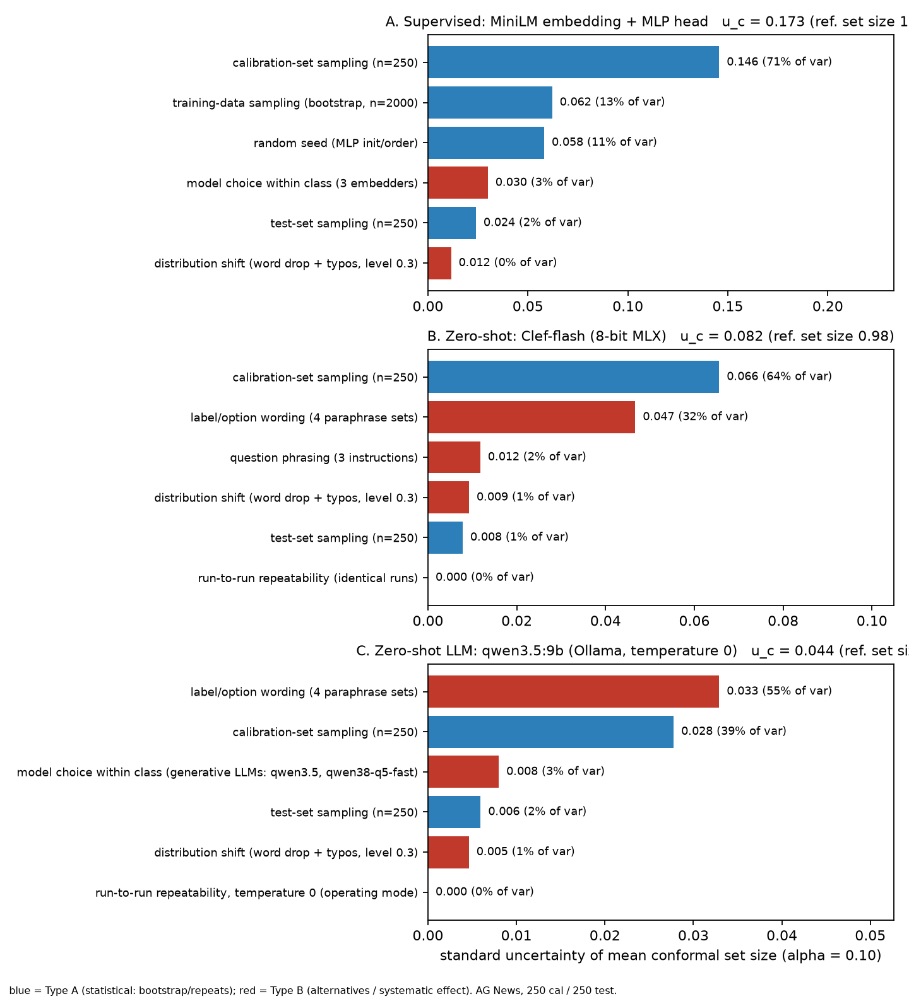
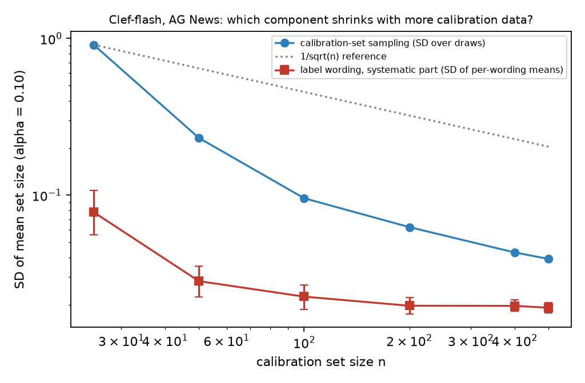
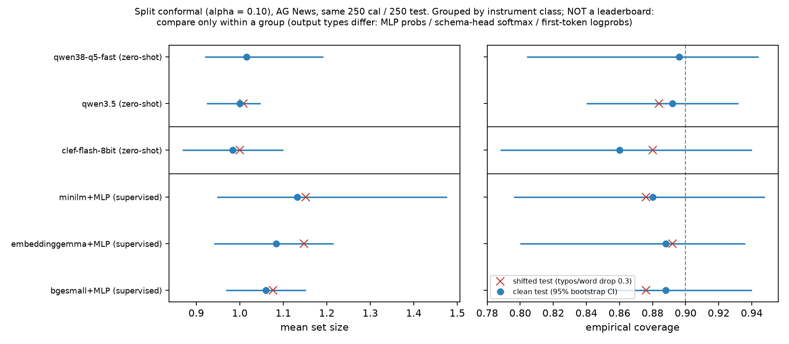
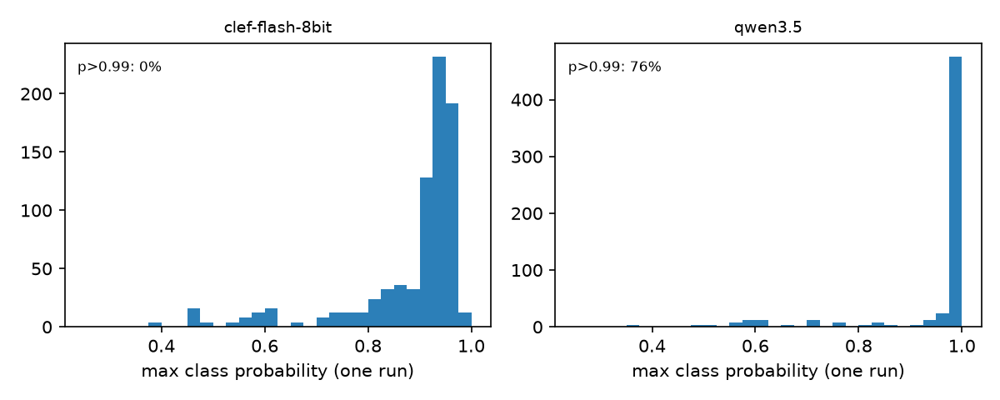

# A GUM-style uncertainty budget for zero-shot and supervised text classifiers

A small, fully open experiment that takes the proposal of Petri & Mari, *Uncertainty Evaluation: Bridging Machine Learning and Measurement Science* ([arXiv:2610.18066](https://arxiv.org/abs/2610.18066)), and applies it to a real pipeline. The proposal: list every uncertainty source, evaluate it (GUM Type A or Type B), combine the sources, and see which dominates.

The paper is conceptual and has **no official code**; arXiv, Hugging Face Papers and GitHub were checked on 2026-10-17. This repository is an independent illustration, **not a reproduction**.

## Question
For a conformal text classifier, where does the uncertainty of the *measured* performance (mean prediction-set size, coverage) come from?

Two follow-ups:
- When an instrument is deterministic, does the uncertainty disappear, or does it move into design choices such as label wording?
- Does the wording component behave like **data scarcity**, shrinking with more data, or like **structural/definitional uncertainty**, which does not?

## Hypotheses
Written during analysis; preregistered-style, **not** formally preregistered.
- **H1.** Run-to-run repeatability is about 0 for deterministic instruments.
- **H2.** Design components (label wording, question phrasing) are of the same order as calibration sampling at n_cal = 250.
- **H3.** Calibration-sampling SD falls roughly as 1/√n; the systematic wording SD has a non-zero floor.
- **H4.** The aleatoric/epistemic split of the same predictions changes with what is called "the ensemble".

Exact metric definitions are in [EXPERIMENT.md](EXPERIMENT.md#hypotheses-and-metric-definitions-stated-before-the-final-analysis-run-but-not-formally-preregistered).

## Method (short)
- **Data.** AG News (`fancyzhx/ag_news` @ `eb185aa`), class-balanced, seed 0.
  - Every model is scored on the **same 250 calibration + 250 test items**.
  - Supervised heads train on 2,000 separate items.
  - The scaling probe uses 500 calibration items.
- **Measurands.** Split conformal prediction, score 1 − p(true), α = 0.10. Y1 = mean set size, Y2 = coverage.
- **Instruments, in three classes.**
  - *Deterministic schema classifier:* `mlx-community/clef-flash-8bit`, the MLX 8-bit build of `Cloudflare/clef-flash`. Option probabilities come from one forward pass.
  - *Generative chat LLMs, via Ollama:*
    - `qwen3.5:9b` (Q4_K_M);
    - Qwen3.8-27B (`unsloth/Qwen3.8-27B-GGUF`, UD-Q5_K_S).
    - The A–D probabilities come from first-token logprobs.
  - *Supervised probes:* all-MiniLM-L6-v2, bge-small-en-v1.5 and embeddinggemma-300m embeddings, each with an MLP head.
- **Budget components.**
  - Repeatability: ≥4 identical runs.
  - Calibration and test sampling: bootstrap.
  - Seed and training bootstrap: probes only.
  - Label wording (4 sets) and question phrasing (3).
  - Model choice *within a class*.
  - Synthetic shift (typos and word drops).
  - Combination: root-sum-square, checked by a GUM-S1-style Monte Carlo.
- **Extras.**
  - Calibrate on one wording, test on another (configuration shift).
  - Option-name vs definition swap: a light version of [arXiv:2609.26758](https://arxiv.org/abs/2609.26758).
  - Entropy-based aleatoric/epistemic decomposition under different ensemble definitions.

**Not a leaderboard.** The classes differ in output type (MLP probabilities, schema-head softmax, first-token logprobs) and in the information they use. Cross-class differences are read only as *how the instrument type changes the uncertainty budget*, never as "X beats Y".

## Results (95% CIs in [EXPERIMENT.md](EXPERIMENT.md) and `tables.md`)

| budget (reference) | combined u(set size) | largest components (share of variance) |
|---|---|---|
| A. MiniLM + MLP, supervised (set size 1.13) | 0.173 | calibration sampling 71%, training bootstrap 13%, seed 11%, embedder choice 3% |
| B. Clef-flash, deterministic (0.98) | 0.082 | calibration sampling 64%, **label wording 32%**, question phrasing 2%, shift 1%, repeatability **0 (measured)**; within-class model choice **not evaluated** |
| C. qwen3.5 9B, temperature 0 (1.00) | 0.044 | **label wording 55%**, calibration sampling 39%, 9B vs 27B 3%, repeatability **0 (measured)** |

Main findings:

- **Repeatability (H1, supported).**
  - Clef: max |Δp| = 0 over 4 × 200 items.
  - qwen3.5 at temperature 0: Δp = 0 over 4 × 150 items.
  - qwen3.5 at default temperature: identical probabilities; 1 of 150 sampled labels changed (Fleiss κ 0.996).
  - Qwen probabilities are saturated (76% of items have max p > 0.99), so its κ and ICC are near-degenerate. See `saturation.png`.
- **Design ≈ sampling (H2, supported).** u(wording)/u(calibration) = 0.71 for Clef and 1.18 for qwen3.5.
- **Data vs structure (H3, suggestive).**
  - Calibration-sampling SD: 0.232 (n=50) → 0.096 (100) → 0.063 (200) → 0.039 (500).
  - Systematic wording SD: 0.028 [0.022, 0.035] → 0.023 → 0.020 → 0.019 [0.018, 0.021]. See `scaling.png`.
- **Configuration shift.** Calibrating on one wording and testing on another widens Clef's coverage range from 0.844–0.864 to 0.800–0.920, while the mean barely moves.
- **Name vs definition (Clef).** 15.2% of decisions flip when option names are bound to the wrong definitions; 14% follow the name.
- **Synthetic shift.** Effect ≤ 0.02 on set size for all models, ≤ 1% of variance. This is a null result for this perturbation.
- **A/E split (H4, supported).**
  - Probes: 22–27% epistemic.
  - Clef, single pass: 0% (by construction).
  - Clef over 6 prompt configurations: 5%.
  - Per-item EU rank agreement across instruments: Spearman 0.42–0.70.

Figures:

**Budgets A/B/C** (`budget_bar.png`)



**H3: calibration-sampling SD vs wording SD as n grows** (`scaling.png`)



**Coverage and set size, grouped by instrument class** (`coverage_setsize.png`)



**Score distributions / saturation** (`saturation.png`)



## Data scarcity vs structural/definitional uncertainty
- **Data scarcity.** Some uncertainty comes from limited data: calibration, training and test sampling. It is "epistemic" in the reducible-by-data sense and shrinks as n grows.
- **Structural/definitional.** Other uncertainty comes from how the task is specified: the label set, its wording, the question asked. More data from the same specification does not remove it.
- **Metrology's term for the floor.** The VIM calls it **definitional uncertainty**: "component of measurement uncertainty resulting from the finite amount of detail in the definition of a measurand", where "any change in the descriptive detail leads to another definitional uncertainty" ([VIM 2.27](https://jcgm.bipm.org/vim/en/2.27.html)).
- **Related distinctions.**
  - Der Kiureghian & Ditlevsen (2009): the aleatoric/epistemic split "is determined by our modeling choices" ([doi](https://doi.org/10.1016/j.strusafe.2008.06.020)).
  - Hüllermeier & Waegeman (2021): the standard ML reference; they note the split is context-dependent ([doi](https://doi.org/10.1007/s10994-021-05946-3)).
  - Lane & Maxfield (2005): separate truth, semantic and *ontological* uncertainty (which categories exist at all) ([doi](https://doi.org/10.1007/s00191-004-0227-7)). That is an innovation-economics concept, so the analogy is ours.
  - Knight's (1921) risk/uncertainty distinction is often invoked; we cite it as background only.
- **What our data show.** The scaling probe is consistent with a wording floor, but only on one dataset, with one pool and four hand-picked wordings.
- **Rival explanation.** Pecher et al. ([arXiv:2602.04297](https://arxiv.org/abs/2602.04297)) argue that much prompt sensitivity is *underspecification*, which a clearer specification would remove.
- **Next test.** Sharpen class definitions, e.g. ontologies as a supportive system for LLMs, and see whether the floor drops.

## Scope and limitations
In brief; the full version is in [EXPERIMENT.md](EXPERIMENT.md#scope-and-limitations).
- **Coverage.**
  - One English dataset, 250/250 items, α = 0.10, LAC score.
  - Pipeline-level (process) uncertainty, not per-prediction.
  - One hardware/software stack per class.
- **Not covered.**
  - Other datasets and languages.
  - Realistic shift and OOD detection.
  - A second schema classifier: GLiNER2 failed to install in reasonable time, so within-class model choice for that class is *not evaluated* (unknown, not zero).
  - 27B repeatability (runtime).
  - PA_Score ([arXiv:2610.04239](https://arxiv.org/abs/2610.04239)), which needs hidden states; a paraphrase-ensemble analogue is reported instead.
  - Cross-stack reproducibility.
- **Threats to validity.**
  - *Internal:* hand-picked alternatives drive the Type B terms, RSS independence is assumed (the Monte Carlo shows it is about 11% conservative), and hypotheses were not preregistered.
  - *External:* AG News is easy and probably seen in pretraining; Reiter et al. ([arXiv:2609.35824](https://arxiv.org/abs/2609.35824)) find far larger design effects on subjective tasks.
  - *Construct:* saturated LLM probabilities make set size nearly constant; Clef allows empty sets.
- **Alternative explanations.**
  - Prompt underspecification (Pecher et al.).
  - Serving-stack determinism rather than model certainty (Vosti, [arXiv:2609.38981](https://arxiv.org/abs/2609.38981)).
  - Saturation masking variability.
  - Calibration noise inside the wording estimate.
- **Supported:** H1, H2 and H4, the name leakage, and the null shift result, all on this setup.
- **Suggestive only:** H3 and any data-vs-structure reading.
- **Not claimed:** any ranking of instrument classes.

## Literature

**For: the split is model-relative or incoherent; design matters.**
- Der Kiureghian & Ditlevsen 2009, [doi](https://doi.org/10.1016/j.strusafe.2008.06.020).
- Hüllermeier & Waegeman 2021, [arXiv:1910.09457](https://arxiv.org/abs/1910.09457).
- Gruber et al., [arXiv:2305.16703](https://arxiv.org/abs/2305.16703).
- Bickford Smith et al., ICML 2025, [arXiv:2412.20892](https://arxiv.org/abs/2412.20892).
- Kirchhof et al., ICML 2025, [arXiv:2505.22655](https://arxiv.org/abs/2505.22655).
- Mucsányi et al., NeurIPS 2024, [arXiv:2402.19460](https://arxiv.org/abs/2402.19460).
- Reiter et al., [arXiv:2609.35824](https://arxiv.org/abs/2609.35824). The scripts repo cited in the paper returned 404, so no original code is available.
- Sun et al., [arXiv:2609.26758](https://arxiv.org/abs/2609.26758).
- Zhu et al., [arXiv:2608.01460](https://arxiv.org/abs/2608.01460).
- Hassanzadeh & Subramanian, [arXiv:2610.13823](https://arxiv.org/abs/2610.13823).
- Sclar et al., ICLR 2024, [arXiv:2310.11324](https://arxiv.org/abs/2310.11324).
- Standards: GUM [JCGM 100](https://www.bipm.org/en/doi/10.59161/JCGM100-2008E), [JCGM 101](https://www.bipm.org/en/doi/10.59161/jcgm101-2008), [VIM](https://doi.org/10.59161/jcgm200-2012).

**Against or qualifying: the split is useful, measures are being repaired, the GUM is debated, wording effects may be artefacts.**
- Kendall & Gal 2017, [arXiv:1703.04977](https://arxiv.org/abs/1703.04977).
- Gal et al. 2017 (BALD), [arXiv:1703.02910](https://arxiv.org/abs/1703.02910).
- Depeweg et al., ICML 2018, [PMLR](https://proceedings.mlr.press/v80/depeweg18a.html).
- Wimmer et al., UAI 2023, [PMLR](https://proceedings.mlr.press/v216/wimmer23a.html).
- Sale et al., UAI 2024, [PMLR](https://proceedings.mlr.press/v244/sale24a.html).
- Pecher et al., [arXiv:2602.04297](https://arxiv.org/abs/2602.04297).
- Qin et al. (Vosti), [arXiv:2609.38981](https://arxiv.org/abs/2609.38981).
- Kacker & Jones 2003, [doi](https://doi.org/10.1088/0026-1394/40/5/305).
- Elster 2014, [doi](https://doi.org/10.1088/0026-1394/51/4/S159).
- Bich et al. 2012, [doi](https://doi.org/10.1088/0026-1394/49/6/702).

Details and caveats are in [lit-review.md](lit-review.md).

## How to reproduce
1. **Analysis only (CPU, minutes).** Raw per-item outputs are committed in `cache/mac/`.
   ```
   pip install -r requirements-box.txt
   python prep_data.py && python embed_box.py
   # embeddinggemma embeddings: run mac/embed_gemma.py (needs Ollama), or drop that probe
   python repeatability.py && python budget.py && python plots.py && python gen_tables.py > tables.md
   ```
2. **Model runs (Apple Silicon, MLX and Ollama 0.40.5).**
   - Set `CLEF_DIR` to a local snapshot of `mlx-community/clef-flash-8bit`; it ships `clef_mlx.py`.
   - Set `CLEF_PY` to a Python with the packages in `requirements-mac.txt`.
   - Pull `qwen3.5:9b` and the Qwen3.8-27B GGUF in Ollama.
   - Run the scripts in `mac/` (order in `mac/run_all.sh`, `mac/run_queue2.sh`, `mac/run_clef_later.sh`), then copy `mac/out/*.jsonl` to `cache/mac/`.
   - The step-by-step list is in `MANIFEST.json` under `regenerate`.
3. **Settings.**
   - Seeds: data 0; bootstraps `default_rng(12345)`; MLP 0–15; Ollama seed 42 at temperature 0, seeds 1000–1003 at default temperature.
   - Ollama: `think=false`, `num_predict=1`, `logprobs=true`, `top_logprobs=20`.
   - Prompts, schemas and wordings: `MANIFEST.json` (`prompts`) and `cache/zs_set.json`.
4. **Runtime notes.** Measured on a 32 GB M5 laptop, per call: Clef about 0.35–0.5 s, qwen3.5 9B about 0.3–0.6 s, 27B about 2.3 s.

**Model weights are not redistributed.** Use the Hugging Face / Ollama IDs and digests in `MANIFEST.json`. `MANIFEST.json` also lists the sha256 of every file in this repo.

## License
MIT (see `LICENSE`). Model and dataset licenses are those of their respective owners.
