# Label wording and calibration size in conformal zero-shot text classification: a preregistered re-test of a GUM-style uncertainty budget (v2, interim report)

*Davut Emre Tasar. Interim report, 2026-10-17, 16:23 Istanbul time (UTC+3); API-LLM sections (T5) added at about 18:10; Mac-session parts added 2026-10-17 and 2026-10-29 (Clef-flash T7 results 2026-10-29, Europe/Madrid). Branch `v2-comprehensive` of https://github.com/detasar/gum-uncertainty-budget-textclf. Preregistration: commit `fab3c8a` (2026-10-17 14:18:58 +0300).*

> **Status: interim.** Local scoring jobs are still running; the API-LLM (T5) part is complete (see [Pending runs](#pending-runs)). This report uses only the results that existed when it was written: 17 zero-shot cells (15 bi-encoder, 1 NLI cross-encoder, 1 small LLM) and 15 supervised reference cells. The NLI family (T1) has a single finished cell: nli-deberta-v3-small on AG News, which finished at 16:21 and was analysed during this session. Ten exploratory API-LLM cells (T5: gpt-6-luna and gpt-4.1-nano on all five datasets, plus option-order and test-retest runs) were added at about 18:10 (§3.10). Every number below is copied from `results/` (mainly `results/report_tables.md`, `results/summary.json`, `results/v1_reanalysis.json`, `results/template_factor.json`, `results/repeatability.json` and `results/repeat_rep0_vs_main.json`).

> **Comparison rule.** Models are compared **only within their own instrument type**. Generative LLMs scored by label likelihood (T3), deterministic zero-shot classifiers (T1 NLI cross-encoders, T2 bi-encoders) and supervised probes (T4) differ in their output and in the information they use. They are never ranked against each other here, in any table or figure. The exploratory closed API LLMs (T5) are generative LLMs too: they are shown and compared **only next to the local LLM (T3)**, never next to the NLI or bi-encoder classifiers. Across types we only compare the *shape* of the budget (which component dominates), never its level.

## Abstract

v1 of this study (an X Article and the public repo above) built GUM-style uncertainty budgets for the mean set size of split-conformal zero-shot text classifiers on AG News. It reported that label wording explained about 32% of the variance and calibration sampling about 64%. It also reported that the wording component stalled near 0.02 as the calibration set grew, which it read as a candidate "definitional" floor. v2 re-tests those claims under a preregistered design. Wording sets are drawn at random from a validity-checked paraphrase population (W = 30 per dataset). They are crossed with 200 random calibration/test splits, and the components are estimated by two-way random-effects method of moments with two-way bootstrap CIs. The design spans five datasets (AG News, BBC News 2024-10 to 2025-06, SST-2, DBpedia-14, MASSIVE-18), three conformal methods and three α levels.

In all 17 zero-shot cells finished so far, the wording component of mean set size is clearly non-zero. At n_cal = 250 it exceeds split sampling in 16 of 17 cells and is more than three times as large in 9 of 17, so the preregistered "comparable magnitude" hypothesis (H1b) is refuted in the direction of wording dominance. For bi-encoders the median σ_wording/σ_split ratio is 2.94 and the median wording share is 0.75 (range 0.31 to 0.88). The single NLI cell (deberta-v3-small, AG News) has a share of 0.82 [0.70, 0.88]; the single LLM cell (Qwen2.5-0.5B, AG News) has 0.92 [0.87, 0.94]. Wording does not shrink with n (all 22 cells after the Mac−session update: slope −0.04 to 0.03): the log-log slope over n ≥ 250 lies between −0.04 and 0.03 in every cell, while split sampling falls with slopes from −0.35 to −0.87. The plateau does not come from having few paraphrases (W = 4 subsets average 0.87 to 0.96 of the W = 30 estimate).

Wording leaves coverage untouched when calibration and test use the same wording (wording share of coverage variance 0.00 everywhere). When the wording changes between calibration and deployment, coverage drops: mean coverage over wording sets falls to as low as 0.732 against a 0.90 target. The size of a label change in meaning predicts how much the predictions move (bi-encoders: Spearman ρ = 0.56 [0.51, 0.62]). Even so, pure case changes reproduce 0.60 (NLI cell) and 0.35 (LLM cell) of the flip rate of valid paraphrases.

Re-analysing the v1 outputs, the published 32% share has a 95% CI of [0.00, 0.84], and the share itself depends on n (0.03 at n = 50 to 0.25 at n = 500 for Clef). The "floor exists" claim is confirmed. The specific share numbers are not a stable property of the instrument. The "definitional" reading is weakened: the floor test separates systematic from random effects, not definitional content from instrument non-invariance.

**Update (Mac session, 2026-10-17 18:24–19:00 UTC+3).** The NLI deberta-v3-small cells are now finished on all five datasets (AG, BBC and SST-2 on the box CPU; DBpedia and MASSIVE on an Apple M5 GPU, after a cross-platform check showed max |Δp| = 8.1e-6 and no argmax flip between the two platforms). With 22 preregistered zero-shot cells (15 bi-encoder, 5 NLI, 2 LLM), H1a stays supported (22/22), H1b stays refuted in the direction of wording dominance (ratio > 3 in 0.59 of cells), H2b and H2c stay supported, and H2a stays not supported. One verdict changed: the LLM dose-response (H3b, T3) is now supported (ρ = 0.29 [0.05, 0.49], 82 variant × model pairs, after the Qwen BBC cell was added). In the deterministic-classifier group (T1 + T2, 20 cells) the median wording share at n = 250 is 0.76 (range 0.31–0.88) and the median σ_w/σ_s is 3.14 (0.79–5.58). ModernBERT NLI, the exploratory GLiNER2.5-Decide cells and the Clef-flash decision-model cells were still running on the Mac when this was written (§3.11, §7).

**Update (resume session, 2026-10-29 01:10–03:50 Europe/Madrid, UTC+1).** The second T1 model, ModernBERT-base-zeroshot-v2.0, is now finished on all five datasets, which gives 27 preregistered zero-shot cells (15 bi-encoder, 10 NLI, 2 LLM). No verdict label changes: H1a supported (27/27), H1b refuted toward wording dominance (ratio > 3 in 17/27 = 0.63), H2a not supported (0.48 of split slopes in the window), H2b and H2c supported, H3c supported (0.78), and case-only changes reach half the valid-paraphrase flip rate in 4/27 cells (0.15). The exploratory GLiNER2.5-Decide encoder classifier (T6, first 600 items) behaves like the preregistered deterministic classifiers: wording share at n = 250 is 0.79–0.83 on AG, BBC, DBpedia and MASSIVE and 0.33 [0.16, 0.43] on SST-2, where its σ_wording is tiny (0.026). Over the 30 deterministic cells (T1 + T2 + T6) the median wording share is 0.79 (0.31–0.90) and the median σ_w/σ_s is 3.41 (0.79–6.06). Clef-flash (T7, matched with gpt-6-luna on 200 items) was still running on the Mac at that time; it finished at 07:15 (next update).

**Update (Clef close-out, 2026-10-29 08:20–08:40 Europe/Madrid, UTC+1).** The exploratory Clef-flash decision-model cells (T7; 5 datasets × first 200 items × official + 30 VALID sets) are finished and analysed with the matched design (test 100, n_cal = 100, same Design-A splits as the gpt-6-luna sub200 cells; Table M3, M3b). Clef has the higher official accuracy than gpt-6-luna on all five datasets (AG 0.930 vs 0.900, BBC 0.905 vs 0.875, SST-2 0.945 vs 0.930, DBpedia 0.995 vs 0.985, MASSIVE 0.920 vs 0.765) and the higher mean VALID accuracy on all five. Its σ_wording (LAC set size, n_cal = 100) is smaller than Luna's on AG (0.326 vs 0.733), SST-2 (0.028 vs 0.154) and MASSIVE (0.149 vs 1.310) and larger on BBC (0.402 vs 0.236) and DBpedia (0.089 vs 0.068); its σ_wording CI excludes 0 in 5/5 cells and the wording share is 0.70–0.78 on AG, BBC, DBpedia and MASSIVE and 0.30 [0.15, 0.39] on SST-2 (Luna: 0.64–0.92). So the second decision model also carries a clear wording component except on the binary SST-2 task, and switching from a closed API model to an open 9B decision model does not remove it. Nothing in this group enters the preregistered verdicts.

An exploratory addition (not preregistered) scores two closed API LLMs, gpt-6-luna (Decisions endpoint, per-option probabilities) and gpt-4.1-nano (chat completions, first-token letter logprobs), on all five datasets (§3.10). Among the LLMs, wording again dominates: the wording share at n = 250 is 0.75–0.96 and σ_w/σ_s is 3.17–9.62 in all 10 API cells. A new source, the **display order of the options**, takes 0.11–0.19 of the set-size variance on AG News and BBC (wording 0.72–0.81, split sampling 0.006–0.031). gpt-6-luna was bitwise repeatable (3 runs; also invariant to batching 1, 8 or 31 questions per request). gpt-4.1-nano was **not**: across 3 runs max |Δp| reached 0.927 and 3.6% of test items (up to 15% in one wording set) changed their LAC set, so v1's "repeatability can be exactly zero" does not hold for this API model.

## 1. Research questions, preregistration and deviations

### 1.1 Preregistration
`plan.md` (research questions, hypotheses, refutation criteria, analysis plan) and `gaps.md` (red-team analysis of v1) were committed as `fab3c8a` at 2026-10-17 14:18:58 +0300. The current `plan.md` is byte-identical to the committed version (checked with `git show fab3c8a:v2/plan.md | diff`). The earliest v2 raw classifier output (`raw/agnews__bienc__all-MiniLM-L6-v2.npz`) is timestamped 14:19:55 Istanbul time, after the commit. `plan.md` discloses what was done before the commit: data pools, paraphrase generation and validity judgement, throughput pilots on ≤ 100 AG News items with official labels, and a bf16 numerics check.

### 1.2 Research questions (from `plan.md`)
- **RQ1 (magnitude).** At n_cal = 250, α = 0.10, LAC: is the wording component of mean set size comparable to split sampling? H1a: σ_wording CI excludes 0 in ≥ 80% of zero-shot cells. H1b: σ_w/σ_s ∈ [1/3, 3] in ≥ 50% of cells. Refuted if the ratio is < 1/3 or > 3 in > 50% of cells.
- **RQ2 (floor).** H2a: split slope in [−0.65, −0.35] (n ≥ 100). H2b: wording slope > −0.15 (n ≥ 250) and σ_w(n_max) CI excludes 0 in ≥ 2/3 of cells. H2c: the W = 4 estimate is within ×[0.8, 1.25] of W = 30.
- **RQ3 (what wording is made of).** H3a: case-only changes flip predictions (≥ 1 model per type). H3b: dose-response ρ > 0. H3c: σ_w(VALID) < σ_w(ALL). The "definitional" reading is refuted if surface-only flip rates are ≥ 50% of valid-paraphrase flip rates in most cells.
- **RQ4 (contamination proxy, exploratory).** H4a: Min-K% Prob higher for AG News than BBC-2025. H4b: lower accuracy and larger σ_w on BBC-2025.
- **RQ5 (repeatability vs reproducibility on CPU).** H5a: identical fp32 runs give max |Δp| = 0. H5b: batch size changes in fp32 give |Δp| < 1e-4; bf16 changes conformal sets.

### 1.3 Deviations from the preregistration (all known ones)
1. **Update 18:55:** deberta-v3-small is now finished on all 5 datasets (DBpedia and MASSIVE scored on the Mac GPU, see deviation 12); ModernBERT-base-zeroshot-v2.0 is running on the Mac (§7). The original text of this item follows. **T1 NLI cross-encoders: one cell instead of 2 models × 5 datasets.** `cross-encoder/nli-deberta-v3-small` on AG News (1,200 items, all strings) finished at 16:21, during this session, and was analysed. deberta on BBC-2025 is running; the other eight T1 cells (deberta on SST-2, DBpedia, MASSIVE and ModernBERT on all five) have not started. A separate BBC subset run (`run_nli_bbc_subset.sh`) was killed by an earlier worker at 16:02 as infeasible under contention (`logs/nli_bbc_subset.log`). All T1 statements therefore rest on one cell, and no within-T1 model comparison is possible.
2. **T3 LLMs: one cell instead of ≥ 2 models × 5 datasets.** Only Qwen2.5-0.5B-Instruct on AG News is finished. Qwen2.5-0.5B on BBC-2025 is running. SmolLM2-360M and the optional Qwen2.5-1.5B have not started. No within-type model comparison is possible for T3, and all T3 numbers are a single cell.
3. **Cell-share thresholds were evaluated on 17 cells, 15 of them bi-encoders.** The "share of cells" criteria in RQ1–RQ3 therefore mostly describe T2. Holm correction was applied across the 17 available cells.
4. **RQ1 H1b flips with the cells available.** With the first 16 cells, exactly 50% had a ratio in [1/3, 3] and 50% a ratio > 3, so H1b was "supported" at the boundary. The 17th cell (NLI, ratio 3.91) moves this to 47% in [1/3, 3] and 53% > 3. The preregistered refutation rule ("> 3 in > 50% of cells": sampling negligible) is now triggered. We report H1b as **refuted, in the direction of wording dominance**, and note that this verdict is fragile: it rests on one cell and may change again as the T1/T3 cells arrive.
5. **RQ4 incomplete.** Min-K% Prob (H4a) has not run (no `results/contamination/` yet). H4b is evaluated for the three bi-encoders only, using point estimates. No CI on the AG−BBC accuracy difference was computed.
6. **RQ5 partial.** At 16:23 only 2 of 4 identical runs existed. By 18:10 all 4 exist for every instrument, and the intermediate-precision conditions have finished for T1 and T2 but not for T3 (§3.7).
7. **Post-queue steps were started early.** An earlier worker launched the repeatability and Min-K% steps before the scoring queues finished (`run_early_after.sh` at about 15:26, then `run_repeat_resume.sh` at 16:02, which skips finished outputs). The commands and arguments are the same as in `run_repeat.sh`/`run_after.sh`, but the runs share the CPU with the scoring jobs. This matters for timing, not for fp32 numerics, which is what RQ5 tests.
8. **Exploratory addition at report time.** `src/repeat_vs_main.py` compares repeat run 0 with the main-grid run of the same model on the same items and shared label strings. It is not preregistered and is labelled exploratory (§3.7).
9. **Crossing points n\* below the grid.** Where n\* (σ_split = σ_wording) is below 50, it is an extrapolation with slope −0.5 outside the measured grid, as the plan allows.
10. **v1 instruments not re-run** (Clef-flash, qwen3.5:9b and the 27B model need the author's Mac). The v1 numbers are only re-analysed from committed outputs (§3.8), so v2 tests the v1 *claims* with different, CPU-feasible instruments.
12. **Hardware change for part of T1 (added 2026-10-17, 18:25–19:00 UTC+3).** The plan says "all inference in fp32 on CPU". The remaining NLI cells were moved to the author's Mac (Apple M5, 32 GB, torch 2.14.1 MPS, transformers 5.20.1, fp32, bs 64, same pair order and batch composition; `mac/src/score_nli.py`, same npz format). deberta-v3-small on DBpedia and MASSIVE were scored there; AG, BBC and SST-2 had already finished on the box CPU. Before stopping the box queue, the finished AG deberta cell was re-scored on the Mac and compared (§3.11.1): max |Δlogit| 4.4e-5, max |Δp| 8.1e-6, 0 argmax flips. The box run of deberta DBpedia (21 min in) was stopped as duplicate work.
13. **Exploratory classifier additions (not preregistered).** Two instruments from the author's local ClipboardGuard app folder (used read-only) were added. (a) **GLiNER2.5-Decide** (DeBERTa-v3-large encoder, about 0.49B parameters in a 1.95 GB fp32 file). Its native classification head gives one logit per candidate label, and the softmax over them is the library's own activation for single-label tasks. That makes it a document-level classifier, not a span-score proxy, so it was included as **T6, encoder schema classifier**, inside the deterministic-classifier group. It was capped at the first 600 items per dataset with the core sets (runtime). (b) **Clef-flash** (Cloudflare, 9B, post-trained from Qwen3.5-9B with a joint schema head; mlx-community 8-bit build). It is not a small encoder classifier, so it forms a **decision-model group (T7)** together with gpt-6-luna (same Decisions paradigm) and is compared only within that group. It was capped at the first 200 items per dataset (official + 30 VALID sets) to keep the run at 1–2 h. The matched comparison analyses gpt-6-luna on exactly those 200 items and sets with a reduced design (test 100, n_cal ≤ 100, same Design-A splits; `UQ_TEST_SIZE=100`). The full 1,200-item Luna cells are kept unchanged. No 27B model was used. Neither group enters the preregistered verdicts.
14. **Code fix in the exploratory GLiNER scorer and resumed Mac queue (2026-10-29, UTC+1).** The 17 Oct GLiNER run failed on every dataset (weights left on the CPU; see §3.11.3), and the 17 Oct Clef run stopped silently after loading the model (no traceback; most likely the Mac slept, since the job ran without `caffeinate`; the Mac rebooted on 20 Oct). The `CLEF_QUEUE_DONE` line in that log came from an earlier, deliberately stopped run (the script printed it unconditionally). The queue was resumed on 29 Oct with `mac/run_seq2.sh` under `caffeinate` (GLiNER x5, then Clef x5; caches kept and resumed). The scoring design and item caps are unchanged.
11. **Exploratory T5 API LLMs replace local LLM cells (added 2026-10-17, not preregistered).** The local LLM queue (T3) is far behind on this CPU box (one finished cell after several hours). To get LLM evidence on all five datasets, two closed API models were scored on 2026-10-17 between 17:10 and 17:58 Istanbul time (UTC+3): `gpt-6-luna` (model id returned: `gpt-6-luna`) via the Decisions endpoint, and `gpt-4.1-nano` (model id returned: `gpt-4.1-nano-2025-04-14`) via chat completions with logprobs. They form their own type T5, are reported separately (`results/api/`, `results/summary_api.json`, `results/summary_with_api.json`), are compared only with T3, and do not enter the preregistered verdicts in §3.1–3.9. Closed models can change silently behind a fixed name. gpt-4.1-nano returned 8 different `system_fingerprint` values within these 48 minutes, and gpt-6-luna returns none. The T5 numbers are therefore a snapshot for that date and these ids, not a property of a reproducible instrument. The option-order factor (§3.10.4) is a new exploratory design element.

## 2. Data and methods

**Measurand (stated explicitly).** Mean prediction-set size (primary). Secondary: coverage, accuracy, ECE, singleton rate and worst-class coverage. These are computed for split-conformal prediction with method C at level α, calibrated on n exchangeable labelled items and evaluated on held-out items, *when the class concepts are verbalised by any meaning-preserving wording*. Under this definition the spread over valid wordings is a candidate for definitional uncertainty: VIM 2.27, called "intrinsic uncertainty" in GUM D.3.4. If the wording is instead part of the procedure, the same spread is a realization/procedure effect (GUM 3.3.2 b, i).

**Datasets.**

| dataset | content | classes | pool size |
|---|---|---|---|
| AG News | topics, 2004–05 news | 4 | 2,600 |
| BBC News 2024-10…2025-06 | same 4 AG classes; published after the release of every model used | 4 | 2,238 |
| SST-2 | sentiment | 2 | 2,600 |
| DBpedia-14 | encyclopedic categories | 14 | 1,400 |
| MASSIVE en-US | voice-assistant request scenarios | 18 | 2,600 |

BBC article texts are not redistributed; only links, labels and SHA-256 hashes are.

**Instruments (within-type only).**
- T1 NLI cross-encoder: cross-encoder/nli-deberta-v3-small, hypothesis "This text is about {label}.", softmax over the entailment logits of the K labels (first 1,200 AG News pool items).
- T2 bi-encoders: all-MiniLM-L6-v2, bge-small-en-v1.5, e5-base-v2. Probability = softmax(cos("text", "This text is about {label}.")/τ) with τ = 0.05.
- T3: Qwen2.5-0.5B-Instruct, scored by PMI label log-likelihood over the first 1,200 pool items.
- T4: logistic regression on the T2 embeddings, refit on 20 training bootstraps (BBC: trained on AG News).
- T5 (exploratory, closed API LLMs, §3.10): **gpt-6-luna** via `POST /v1/decisions`, with one multiple-choice question per wording set whose choices are the K label strings. The API returns a probability per choice. Questions are batched 60 per request (31 for the order and retest runs), and a pilot showed that batching does not change any output. **gpt-4.1-nano** via `/v1/chat/completions` with temperature 0, max_tokens 1, logprobs and top_logprobs = 20. The options are listed as letters A, B, C, …, and a class score is log p(first token = its letter), combining the "X" and " X" token variants. A letter missing from the top 20 gets the smallest returned top-20 logprob, which is an upper bound, and is counted as missing. Refusals and missing answers become a uniform distribution. Luna probabilities are floored at 1e-4 because many are exactly 0. Items: the first 1,200 pool items (DBpedia 1,000), all VALID sets and controls. Code: `src/score_api.py`, `src/api_build.py`, `src/api_order.py`, `src/api_tables.py`, `src/api_figures.py`, `src/api_quant_jumps.py`.
- The second NLI model (ModernBERT-base-zeroshot-v2.0) is finished (2026-10-29, §3.11.2). The second LLM (SmolLM2-360M-Instruct) is not (stopped for the preprint).
- Everything ran in fp32 on CPU with torch 2.14.1+cpu and transformers 5.20.1.

**Wording population.** Each class has candidate wordings from generators G0–G7:
- G0: official name
- G1: case change only
- G2: WordNet synonym
- G3: WordNet hypernym
- G4: χ² keywords from the training split
- G5: a fixed short definition
- G6 and G7: two Qwen2.5-3B paraphrases
- the four v1 hand sets, for AG News and BBC

A candidate is VALID if the judges (all-mpnet-base-v2 and roberta-large-mnli, neither used as a classifier) find it discriminable and the researcher audit does not reject it. STRICT additionally requires judge cosine ≥ 0.5; ALL is every candidate. The main analysis uses W = 30 random VALID sets per dataset (seed 2026), the same sets for every model. Controls: identity, surface-only (case), nonsense pseudo-words, shuffled names.

**Design A (primary).** For each n, S = 200 random splits (test = 300, calibration = n of the rest) are crossed with the W sets. Two-way crossed random-effects method of moments gives σ²_w, σ²_s and σ²_ws+e, with negative estimates truncated at 0. 95% CIs come from a two-way bootstrap (wordings × splits, 1,000 draws). **Design B (v1 replication):** a fixed 300-item test set, with calibration bootstrapped from the rest.

**Conformal methods.** LAC, APS (randomised) and RAPS (λ = 0.01, k_reg = 1), at α ∈ {0.05, 0.10, 0.20}.

**Code.** `src/analyze.py`, `src/aggregate.py`, `src/report_tables.py`, `src/figures.py`, `src/template_factor.py`, `src/repeat_analysis.py`, `src/v1_reanalysis.py`.

## 3. Results

### 3.1 RQ1: magnitude at n_cal = 250 (Table 1 in `results/report_tables.md`)
H1a is **supported**: the σ_wording CI excludes 0 in 17/17 cells, and all Holm-corrected F tests are significant. H1b is **refuted, with sampling negligible relative to wording** (deviation 4): 0.47 of cells have a ratio in [1/3, 3], 0.53 have a ratio > 3, and none has a ratio < 1/3.

| type | dataset | model | σ_wording [95% CI] | σ_split | ratio [CI] | wording share [CI] |
|---|---|---|---|---|---|---|
| T2 | AG News | MiniLM-L6 | 0.341 [0.237, 0.426] | 0.105 | 3.25 [2.10, 4.19] | 0.80 [0.65, 0.86] |
| T2 | AG News | bge-small | 0.255 [0.175, 0.312] | 0.103 | 2.47 [1.67, 2.95] | 0.70 [0.55, 0.77] |
| T2 | AG News | e5-base | 0.399 [0.236, 0.528] | 0.084 | 4.75 [2.63, 6.29] | 0.88 [0.73, 0.92] |
| T2 | BBC 2024-25 | MiniLM-L6 | 0.199 [0.156, 0.237] | 0.100 | 1.99 [1.47, 2.42] | 0.58 [0.45, 0.67] |
| T2 | BBC 2024-25 | bge-small | 0.169 [0.131, 0.198] | 0.094 | 1.80 [1.32, 2.14] | 0.50 [0.37, 0.58] |
| T2 | BBC 2024-25 | e5-base | 0.212 [0.157, 0.256] | 0.087 | 2.45 [1.72, 2.99] | 0.65 [0.50, 0.74] |
| T2 | SST-2 | MiniLM-L6 | 0.109 [0.086, 0.126] | 0.022 | 4.85 [3.47, 5.43] | 0.80 [0.72, 0.84] |
| T2 | SST-2 | bge-small | 0.119 [0.097, 0.132] | 0.040 | 2.94 [2.32, 3.37] | 0.80 [0.73, 0.83] |
| T2 | SST-2 | e5-base | 0.135 [0.106, 0.153] | 0.038 | 3.57 [2.62, 4.22] | 0.84 [0.76, 0.88] |
| T2 | DBpedia-14 | MiniLM-L6 | 0.870 [0.643, 1.060] | 0.272 | 3.19 [2.16, 4.08] | 0.76 [0.63, 0.83] |
| T2 | DBpedia-14 | bge-small | 0.906 [0.595, 1.196] | 0.294 | 3.08 [1.97, 3.97] | 0.75 [0.58, 0.83] |
| T2 | DBpedia-14 | e5-base | 0.750 [0.583, 0.889] | 0.166 | 4.53 [3.23, 5.49] | 0.85 [0.77, 0.88] |
| T2 | MASSIVE-18 | MiniLM-L6 | 0.687 [0.548, 0.798] | 0.577 | 1.19 [0.93, 1.41] | 0.47 [0.36, 0.55] |
| T2 | MASSIVE-18 | bge-small | 0.796 [0.650, 0.910] | 0.573 | 1.39 [1.10, 1.65] | 0.56 [0.45, 0.63] |
| T2 | MASSIVE-18 | e5-base | 0.580 [0.434, 0.718] | 0.734 | 0.79 [0.59, 0.98] | 0.31 [0.20, 0.40] |
| T1 | AG News | nli-deberta-v3-small | 0.340 [0.251, 0.413] | 0.087 | 3.91 [2.58, 5.06] | 0.82 [0.70, 0.88] |
| T3 | AG News | Qwen2.5-0.5B | 0.453 [0.344, 0.537] | 0.071 | 6.38 [4.43, 7.51] | 0.92 [0.87, 0.94] |

Within T2, the median ratio is 2.94 and the median wording share is 0.75. MASSIVE-18 (18 classes, short requests) is the only dataset where sampling is of the same order as or larger than wording (share 0.31 to 0.56).

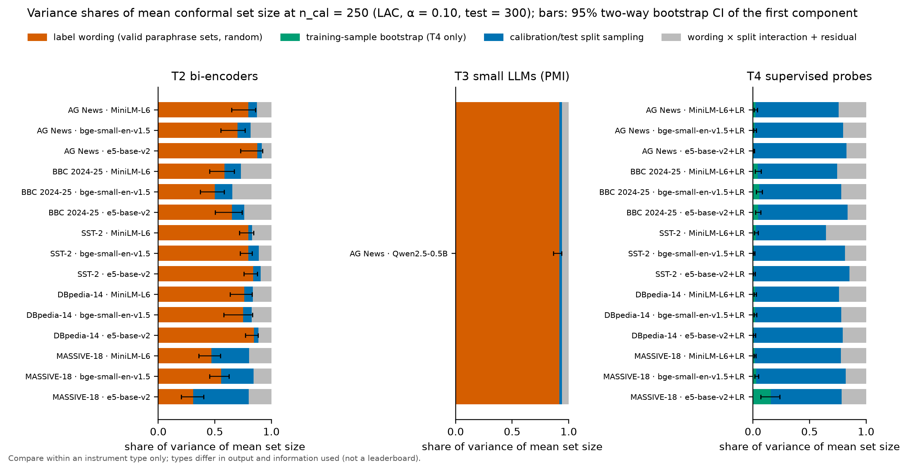

*Figure 1. Variance shares of mean set size at n_cal = 250 (LAC, α = 0.10). Compare within a panel only.*

**Coverage.** The wording share of coverage variance is 0.00 in every cell (upper CI ≤ 0.02; Table 1b). This holds when calibration and test use the same wording, where conformal coverage is guaranteed. Mean coverage was within 0.007 of 1 − α across all cells × methods × α × n (Table 6).

**Methods and α (Table 6, Fig. 5).** For T2 the median wording share is 0.71–0.75 under LAC, 0.53–0.67 under APS and 0.55–0.68 under RAPS across α ∈ {0.05, 0.10, 0.20}. The dominance of wording is therefore not specific to LAC, though it is somewhat smaller with the adaptive scores. The T1 cell gives 0.75–0.87 and the T3 cell 0.83–0.92 across methods and α.

**Probability scale (Table 9, Fig. 16).** Changing τ from 0.05 to 0.02 or 0.1 moves the T2 wording share by at most 0.13 (MASSIVE e5: 0.31 becomes 0.44 at τ = 0.02); in most cells it moves by ≤ 0.03. For the T3 cell, raw log-likelihood instead of PMI gives 0.97 instead of 0.92.

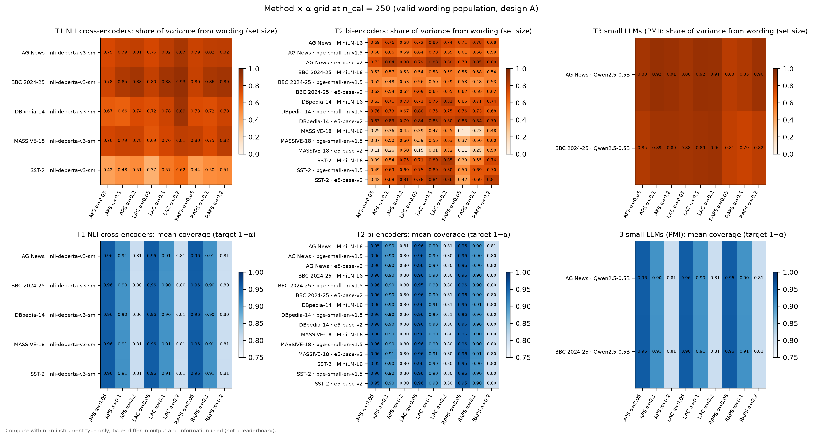

*Figure 5. Wording share across conformal method and α at n = 250.*

### 3.2 RQ2: the floor (Table 2, 2b, 2c)
- **H2b supported (17/17 cells).** The log-log slope of σ_wording over n ≥ 250 lies between −0.04 and 0.03. The CI at n_max excludes 0 in every cell (for example, AG MiniLM σ_w(n_max = 2,300) = 0.332 [0.227, 0.409]).
- **H2a not supported.** Split sampling falls in every cell, but only 53% of slopes fall in the preregistered window [−0.65, −0.35]. The T2 range is −0.35 (SST-2 MiniLM) to −0.87 (DBpedia e5); the T1 cell is −0.52 [−0.60, −0.42] and the T3 cell −0.64 [−0.74, −0.53]. The steeper slopes appear near n_max (Fig. 3). One plausible reading, not tested here, is that the calibration set then exhausts the finite pool. Either way, sampling noise falls *at least* as fast as 1/√n.
- **H2c supported (17/17).** The mean of σ_w over 200 random W = 4 subsets is 0.87–0.96 of the W = 30 estimate, and the spread narrows as W grows (AG MiniLM: W = 4 [0.091, 0.591], W = 8 [0.167, 0.464], W = 16 [0.226, 0.411]). The v1-style estimator (population SD of 4 means) averages lower (AG MiniLM 0.280 vs 0.341), as expected for ddof = 0.
- **Crossing point.** n\* (σ_split = σ_wording) is between 3 and 31 for AG News (including 15 for the NLI cell), BBC, SST-2 and DBpedia (below the grid; extrapolated), and 78 to 302 for MASSIVE. v1 projected a crossing around n ≈ 2,000 for Clef. For these instruments, wording already dominates at any practical calibration size.
- **Design B (v1 replication, Table 2c)** gives the same picture. For AG MiniLM, σ_split falls from 0.253 (n = 50) to 0.034 (n = 2,300) while σ_wording stays at 0.345 → 0.340. For the NLI cell: σ_split 0.197 → 0.046 (n = 50 → 900), σ_wording 0.333 → 0.351.

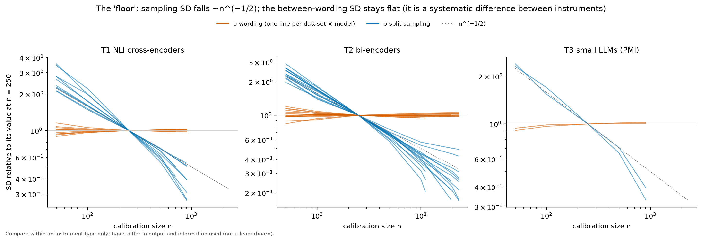

*Figure 3. σ_wording (orange) and σ_split (blue), each normalised to its value at n = 250.*

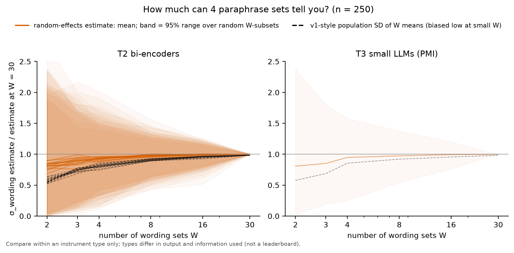

*Figure 9. How the σ_wording estimate and its spread depend on the number of paraphrase sets W.*

### 3.3 RQ3: what the wording component is made of (Table 3, 3b, 4b)
- **Surface-only control (H3a).** For all T2 bi-encoders, case-only changes flip 0.000 of predictions (Clopper-Pearson upper bound ≤ 0.003). The T2 encoders may well normalise case, so for T2 this control cannot tell non-invariance apart from definitional spread (pre-declared exploratory for T2). For the T3 cell, case-only changes flip 0.151 of predictions on average (max 0.210 [0.187, 0.234]). That is 0.35 of the valid-paraphrase flip rate (0.429), below the preregistered 0.50 refutation threshold. For the T1 NLI cell, case-only changes flip 0.215 on average (max 0.292 [0.266, 0.318]), which is **0.60** of its valid-paraphrase flip rate (0.359). That cell is above the 0.50 threshold, but it is only 1 of 17 cells (share ≥ 0.5: 0.06), so the preregistered majority criterion for refuting the "definitional" reading is not met. H3a is supported for T1 and T3. About a third (LLM) to well over half (NLI) of the wording sensitivity of these cross-attention instruments is reproduced by changes that carry no meaning at all.
- **Dose-response (H3b).** T2: supported, ρ(semantic distance, total-variation shift) = 0.56 [0.51, 0.62] over 936 variant × model pairs, and 0.48–0.63 per dataset. T1: supported, ρ = 0.51 [0.23, 0.72] over 41 pairs; mean TV shift 0.129 for valid variants and 0.207 for invalid ones. T3: not supported, ρ = 0.28 [−0.06, 0.58] over 41 pairs. **Update (Mac session):** with the Qwen BBC cell added, T3 is now *supported*, ρ = 0.29 [0.05, 0.49] over 82 pairs, and the T1 estimate over all five deberta cells is ρ = 0.44 [0.32, 0.55] over 240 pairs. The mean TV shift is identical for valid and invalid variants (0.192 and 0.192), so this LLM's prediction shifts do not track meaning.
- **Validity filtering (H3c).** Supported: σ_w(VALID) < σ_w(ALL) in 0.88 of cells (exceptions: SST-2 MiniLM 0.109 vs 0.078; Qwen AG 0.453 vs 0.415). Filtering removes part, not all, of the spread. For DBpedia MiniLM, σ_w is 0.549 for STRICT, 0.870 for VALID and 1.706 for ALL.
- **Definitions vs names (Table 4b, exploratory).** The homogeneous G5 sets (every class given its short definition) give smaller mean sets than the official names in all 15 T2 cells. Examples: AG MiniLM 2.04 → 1.46, DBpedia MiniLM 3.50 → 1.37, MASSIVE e5 10.27 → 4.79. This is consistent with an underspecification component (Pecher et al.) in the *level*. Whether definitions also shrink the *spread* was not measured, because no population of alternative definitions was scored. For the T1 cell, definitions also shrink sets and raise accuracy (2.26 → 1.60; accuracy 0.643 → 0.774). For the T3 cell, definitions keep the set size (2.26 → 2.23) but lower accuracy (0.654 → 0.454).

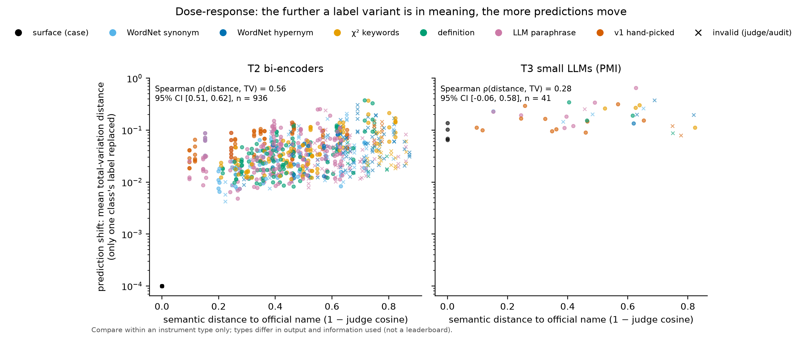

*Figure 4. Prediction shift vs semantic distance of a single class label from the official name.*

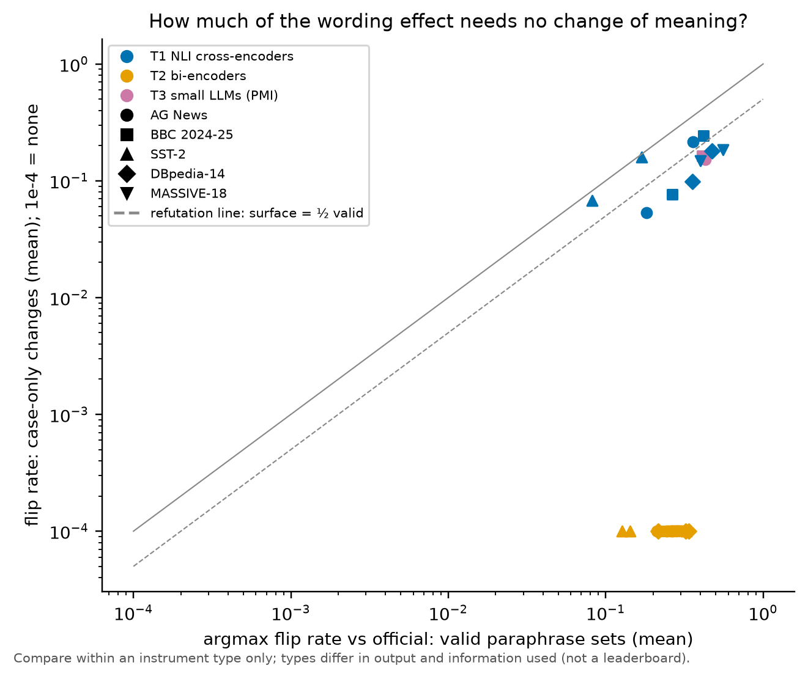

*Figure 15. Flip rates from case-only changes vs valid paraphrases.*

### 3.4 Configuration shift: calibrate with the official names, deploy with another valid wording (Table 5)
The coverage guarantee holds only when calibration and deployment use the same wording. Mean coverage over the 30 valid sets ranges from 0.732 (SST-2 MiniLM; 0.77 of sets below 0.85) to 0.908 (MASSIVE MiniLM). For the T1 AG cell it is 0.813 (min 0.617; 0.57 of sets below 0.85). For the T3 AG cell it is 0.770, with 0.70 of sets below 0.85 and a minimum of 0.514. The AG News bi-encoders give 0.877–0.900, with minima 0.787–0.818.

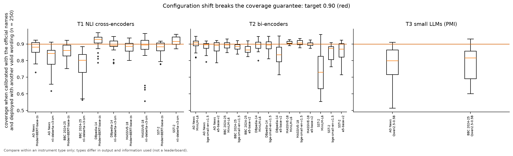

*Figure 13. Coverage when calibrating on official names and deploying with each valid wording set (target 0.90).*

### 3.5 Controls and the supervised reference (Table 4, Table 8)
- **Identity control.** Flip rate 0.000 in all cells, so the pipeline is sound.
- **Nonsense labels.** Accuracy near chance, e.g. AG MiniLM 0.196 against chance 0.25, DBpedia 0.064–0.077 against 0.071.
- **Shuffled names.** Accuracy below chance in every cell, e.g. AG bi-encoders 0.074–0.093, SST-2 0.140–0.315 against 0.50. The T1 cell gives nonsense 0.276 and shuffled 0.125 against chance 0.25. The instruments use label semantics.
- **T4 supervised probes (wording-free by construction).** σ_train-bootstrap is 0.003–0.050 and σ_split 0.024–0.100 at n = 250, so the budget is dominated by split sampling (Fig. 14).
- **AG → BBC real shift.** Probe accuracy is 0.850–0.863 on BBC 2024-25, against 0.875–0.898 on AG News (same probes, within T4).

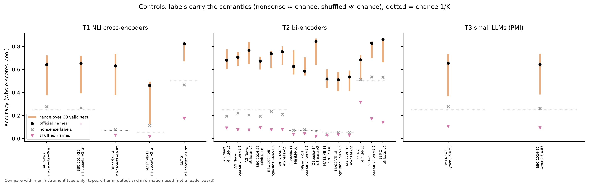

*Figure 10. Accuracy with official, valid, nonsense and shuffled labels (dotted: chance).*

### 3.6 RQ4: AG News vs BBC 2024-25 (Table 7; partial)
For the three bi-encoders, mean valid-set accuracy is lower on BBC in 3/3 models:

| model | AG News | BBC 2024-25 |
|---|---|---|
| MiniLM | 0.689 | 0.663 |
| bge-small | 0.700 | 0.692 |
| e5-base | 0.756 | 0.739 |

The differences are small, and no CI was computed. With official names, bge-small is *higher* on BBC (0.738 vs 0.708).

σ_wording is **smaller** on BBC in 3/3 models (0.199 vs 0.341, 0.169 vs 0.255, 0.212 vs 0.399), the opposite of H4b. Saturation (max p > 0.99) is ≤ 0.003 on both. For T2, the idea that contamination is what keeps AG wording effects small is not supported: if anything, AG shows *more* wording spread. H4a (Min-K%) and the LLM side are pending. The T3 AG cell has 0.273 of items with max p > 0.99.

### 3.7 RQ5: repeatability (partial; Table 10, Fig. 7)
- **Identical fresh-process runs (fp32, same settings).** 2 runs each so far for nli-deberta-v3-small and bge-small (200 AG News items) and Qwen2.5-0.5B (100 items), × 5 wordings: max |Δp| = 0.0, ICC = 1.000, Fleiss κ = 1.000, and 0.000 of conformal sets changed. H5a holds so far for T1, T2 and T3.
- **Update at about 18:10 (Table 10 regenerated).** `results/repeatability.json` now holds 4 identical runs per local instrument (T1, T2, T3), all with max |Δp| = 0 and no set changes, and the intermediate-precision conditions for T1 and T2 (5 wordings each, compared with rep0):
  - fp32 with 1 thread: max |Δp| = 0.
  - fp32 with batch size 1: max |Δp| ≤ 1e-6 (T1) and ≤ 3e-6 (T2), with no argmax flips and no set changes.
  - bf16 (batch size 64 or 1): max |Δp| 0.056–0.183 for T1 and 0.011–0.025 for T2, with argmax flips 0.005–0.02 and 0.01–0.11 (T1) and 0.00–0.07 (T2) of conformal test sets changed.

  H5b is therefore **supported for T1 and T2**: batch changes in fp32 stay below 1e-4, and bf16 changes conformal sets. The T3 conditions are not available yet (the Qwen fp32 batch-size-1 run was in progress at 18:06). For the API LLMs see §3.10.2–3.10.3.
- **Exploratory: repeat run 0 vs the main-grid run** (`results/repeat_rep0_vs_main.json`). Same model, dtype and nominal settings, but a different process with different batch composition: the main runs scored more strings and items. Here the results are **not** bit-identical. For bge-small, max |Δp| = 2.0e-6 (raw cosine 3.6e-7). For Qwen2.5-0.5B, max |Δp| = 1.8e-5 (raw PMI 8.9e-5). Neither changes any argmax. This anticipates the reproducibility/repeatability distinction (VIM 2.25 vs 2.21) that H5b is designed to test.

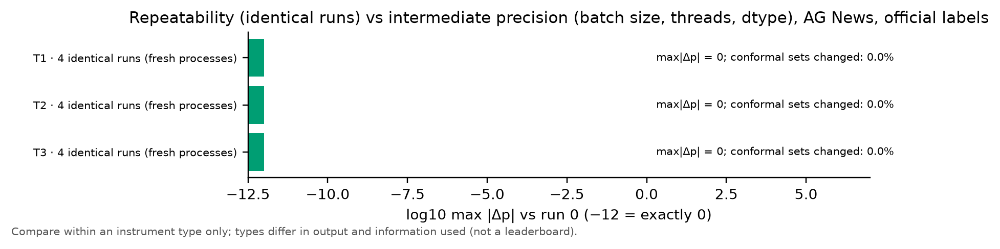

*Figure 7. Repeatability of identical fresh-process runs (partial: 2 runs).*

### 3.8 Re-analysis of the published v1 numbers (Table 12, Fig. 12)
- **Clef.** Published u_wording 0.047 (population SD, W = 4); with ddof = 1, 0.054 with χ² 95% CI [0.031, 0.201]. The published-style wording share (wording vs calibration only) is 0.34 with bootstrap CI [0.00, 0.84]. Under the v2 random-effects method the share is 0.23 [0.01, 0.37] and the ratio 0.69 [0.11, 1.07]. The share also depends on n: 0.03 (n = 50), 0.06 (100), 0.12 (200), 0.15 (250), 0.20 (400), 0.25 (500), with σ_w steady at 0.021–0.039 while σ_s falls 0.192 → 0.034.
- **qwen3.5.** Published 0.033; ddof = 1 0.038 [0.022, 0.142]; published-style share 0.56 [0.00, 0.95]; v2-method share 0.36 [0.01, 0.58]; ratio 1.18 [0.13, 1.59].
- **Coverage.** Under the v2 method the wording share of coverage is 0.01 [0.00, 0.03] for Clef and 0.08 [0.01, 0.12] for qwen3.5.

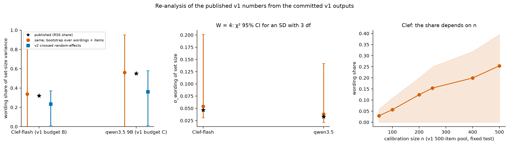

*Figure 12. Published v1 numbers re-analysed from committed v1 outputs.*

### 3.9 Exploratory: the template factor (Table 11, T2 only)
Three hypothesis templates ("This text is about {}.", "{}", "Category: {}.") were crossed with W valid sets and 200 splits at n = 250:
- σ_wording exceeds σ_template in 12 of 15 bi-encoder cells.
- The exceptions are BBC bge (0.133 vs 0.193), BBC e5 (0.198 vs 0.244) and MASSIVE e5 (0.657 vs 1.349).
- The template × wording interaction is often of the same order as the template main effect (e.g. AG e5: 0.263 vs 0.173).

The template is a second, separate source of the same kind, and the wording estimate depends on which template it is measured under (σ_w within template, BBC e5: 0.212 / 0.571 / 0.201).

### 3.11 Mac session: NLI cells, cross-platform check, T6/T7 (exploratory parts marked; tables in `results/mac_tables.md`)

#### 3.11.1 Cross-platform repeatability (exploratory; hardware/backend change, Table M1)
The finished AG News deberta-v3-small cell (1,200 items × 53 label strings) was re-scored on the Mac GPU (MPS, fp32), with the same torch/transformers versions, pair order and batches as the box CPU run. Max |Δlogit| = 4.4e-5 (mean 2.7e-6; 3.8% of logits bitwise equal). Max |Δp| over all 117 scorable wording sets = 8.1e-6. Argmax flips: 0. LAC sets (n_cal = 250, α = 0.10, 200 shared splits, each platform calibrating its own threshold) changed for 3.0e-6 of test items on average. The largest change in one split was 1 of 300 items, and 13 of 117 sets had any change at all. The official set had none. This is a reproducibility result under changed conditions (another device and kernel library), not a repeatability result under identical conditions. It is not bit-exact, but it is three to four orders of magnitude below the bf16 effects in §3.7. Runtime: 410 s on the Mac vs 6,348 s on the box.

#### 3.11.2 NLI deberta-v3-small on all five datasets (preregistered T1 cells; Table M2)
| dataset | N | σ_wording [95% CI] | σ_split | ratio | wording share [CI] | config-shift mean coverage (min) |
|---|---|---|---|---|---|---|
| AG News | 1200 | 0.340 [0.251, 0.413] | 0.087 | 3.91 | 0.82 [0.70, 0.88] | 0.813 (0.617) |
| BBC 2024-25 | 1200 | 0.436 [0.348, 0.501] | 0.078 | 5.58 | 0.88 [0.82, 0.91] | 0.774 (0.564) |
| SST-2 | 1200 | 0.070 [0.054, 0.085] | 0.033 | 2.10 | 0.57 [0.43, 0.67] | 0.919 (0.871) |
| DBpedia-14 | 1000 | 1.203 [0.904, 1.433] | 0.321 | 3.74 | 0.78 [0.64, 0.85] | 0.891 (0.784) |
| MASSIVE-18 | 1200 | 1.374 [0.997, 1.624] | 0.379 | 3.62 | 0.76 [0.62, 0.82] | 0.866 (0.556) |

- Floor: the σ_wording slope over n ≥ 250 is 0.008 to 0.019 in the five T1 cells, the split slope −0.47 to −0.72, and n* is 7 to 31.
- Case-only changes flip 0.16–0.24 of predictions on average (max 0.195–0.343, all CIs exclude 0). Relative to the valid-paraphrase flip rate that is 0.60 (AG), 0.59 (BBC), 0.94 (SST-2), 0.38 (DBpedia) and 0.33 (MASSIVE). So 3 of the 5 T1 cells are above the 0.50 line. Over all 22 cells the share is 0.14, so the preregistered majority criterion is still not met. Within T1, though, most of the cells now point to instrument non-invariance.
- Dose-response for T1 over 240 pairs: ρ = 0.44 [0.32, 0.55] (supported).
- RQ4 for T1: VALID accuracy 0.582 (AG) vs 0.571 (BBC). σ_w is *larger* on BBC (0.436 vs 0.340), the opposite of the bi-encoders.

**ModernBERT-base-zeroshot-v2.0 (second T1 model, preregistered; scored on the Mac 17 Oct, analysed 29 Oct; Table M2).**

| dataset | N | acc official | acc VALID mean [min, max] | σ_wording [95% CI] | σ_split | ratio | wording share [CI] | config-shift mean coverage (min) |
|---|---|---|---|---|---|---|---|---|
| AG News | 1200 | 0.853 | 0.799 [0.622, 0.885] | 0.382 [0.260, 0.463] | 0.072 | 5.28 | 0.90 [0.82, 0.93] | 0.871 (0.729) |
| BBC 2024-25 | 1200 | 0.803 | 0.740 [0.566, 0.849] | 0.389 [0.283, 0.492] | 0.072 | 5.39 | 0.89 [0.80, 0.93] | 0.856 (0.753) |
| SST-2 | 1200 | 0.903 | 0.874 [0.775, 0.915] | 0.094 [0.065, 0.116] | 0.031 | 3.06 | 0.81 [0.67, 0.87] | 0.875 (0.778) |
| DBpedia-14 | 1000 | 0.652 | 0.664 [0.443, 0.822] | 0.851 [0.602, 1.068] | 0.141 | 6.02 | 0.90 [0.81, 0.93] | 0.916 (0.787) |
| MASSIVE-18 | 1200 | 0.613 | 0.532 [0.397, 0.626] | 1.022 [0.795, 1.212] | 0.421 | 2.43 | 0.70 [0.58, 0.78] | 0.882 (0.801) |

ModernBERT is more accurate than deberta-v3-small on AG, BBC and SST-2 but has the same wording-dominated budget (share 0.70–0.90, ratio > 3 in 4/5 cells). Within T1 (10 cells) the median share is 0.82 (0.57–0.90) and the median ratio 3.83 (2.10–6.02). The T1 dose-response over 480 variant × model pairs is ρ = 0.48 [0.40, 0.56] (supported; was 0.44 [0.32, 0.55] on 240 pairs).

**Deterministic-classifier group (T1 + T2 + T6, 30 cells; updated 2026-10-29).** At n = 250 the median wording share is 0.79 (range 0.31–0.90) and the median ratio 3.41 (0.79–6.06; ratio > 3 in 19/30). Without the exploratory T6 cells (25 preregistered cells) the values are 0.78 (0.31–0.90) and 3.19 (0.79–6.02; > 3 in 15/25). Re-evaluating the preregistered criteria on the 30 deterministic cells (`results/summary_det.json`, exploratory) gives H1a supported (30/30), H1b refuted (ratio > 3 in 0.63), H2a not supported (0.40), H2b supported (1.00), H2c supported (1.00) and H3c supported (0.82). Under the configuration shift (calibrate with official names, deploy with a valid wording), mean coverage per cell is 0.732–0.974 and the lowest single wording set reaches 0.554.

#### 3.11.3 GLiNER2.5-Decide (T6, exploratory) and Clef-flash (T7 decision model, exploratory)
**GLiNER2.5-Decide (T6).** Scored on the Mac on 2026-10-29 between 02:00 and 03:20 (UTC+1), first 600 items per dataset (deviation 13), core sets (official, 30 VALID, surface, identity, shuffled), torch 2.14.1 MPS fp32, 365–1,847 s per dataset. The 17 Oct attempt had produced no output: the library's `Classifier.from_pretrained(device='mps')` only records the device, so the weights stayed on the CPU and every batch failed with "Passed CPU tensor to MPS op"; the queue script hid the exit code. The fix moves the model explicitly (`clf.to('mps')`) and asserts the device (deviation 14). Test size 300, so n_cal ≤ 300; budget at n = 250, LAC, α = 0.10:

| dataset | K | acc official | acc VALID mean [min, max] | mean set size | coverage | σ_wording [95% CI] | σ_split | ratio | wording share [CI] | config-shift mean coverage (min) | surface / valid flip rate |
|---|---|---|---|---|---|---|---|---|---|---|---|
| AG News | 4 | 0.723 | 0.750 [0.658, 0.818] | 1.785 | 0.904 | 0.332 [0.181, 0.427] | 0.090 | 3.69 | 0.83 [0.62, 0.88] | 0.973 (0.932) | 0.019 / 0.178 (0.11) |
| BBC 2024-25 | 4 | 0.718 | 0.722 [0.523, 0.818] | 1.733 | 0.905 | 0.297 [0.198, 0.375] | 0.075 | 3.97 | 0.83 [0.69, 0.89] | 0.974 (0.906) | 0.023 / 0.214 (0.11) |
| SST-2 | 2 | 0.892 | 0.892 [0.860, 0.903] | 1.032 | 0.903 | 0.026 [0.015, 0.033] | 0.029 | 0.92 | 0.33 [0.16, 0.43] | 0.908 (0.882) | 0.011 / 0.050 (0.21) |
| DBpedia-14 | 14 | 0.880 | 0.837 [0.762, 0.918] | 1.387 | 0.904 | 0.390 [0.233, 0.508] | 0.064 | 6.06 | 0.79 [0.73, 0.86] | 0.854 (0.779) | 0.032 / 0.153 (0.21) |
| MASSIVE-18 | 18 | 0.652 | 0.592 [0.463, 0.710] | 4.547 | 0.902 | 1.047 [0.879, 1.173] | 0.265 | 3.95 | 0.82 [0.76, 0.86] | 0.877 (0.810) | 0.099 / 0.305 (0.32) |

- **Same pattern as the preregistered deterministic classifiers.** σ_wording's CI excludes 0 in 5/5 cells and the ratio is > 3 in 4/5 (3.69–6.06). SST-2 is the exception: GLiNER's predictions barely move with the wording (valid flip rate 0.050, VALID accuracy 0.860–0.903), so σ_wording (0.026) is about equal to split sampling.
- **Coverage.** Matched calibration and test wording gives 0.902–0.905 (target 0.90). Under the configuration shift GLiNER *over*-covers on AG and BBC (mean 0.973 / 0.974) and under-covers on DBpedia (0.854, min 0.779) and MASSIVE (0.877, min 0.810): the direction of the shift depends on the dataset, not only its size.
- **Surface control.** Case-only changes flip 0.011–0.099 of predictions, 0.11–0.32 of the valid-paraphrase flip rate, so none of the T6 cells reaches the 0.50 line (T1 deberta: 3 of 5). GLiNER is less sensitive to pure surface form than the NLI cross-encoders.
- Shuffled-name accuracy is 0.003–0.143 (far below chance on DBpedia and MASSIVE), so the model follows the label meaning, not the position.

**Clef-flash (T7).** Scored on the Mac on 2026-10-29 from 03:19:31 to 07:15:14 (UTC+1) under `caffeinate` (`run_clef.sh` via `run_seq2.sh`, exit code 0; 978 new items in 14,137 s, resuming the 22 AG News items kept from 17 Oct). MLX 8-bit build, one `choice` question per wording set and item, P = softmax(option logits). First 200 items per dataset (deviation 13), official + 30 VALID sets; each cache has exactly 200 items (i = 0–199) × 31 sets, no non-finite logits, and the box copies have the same sha256 as the Mac files. Matched design: test 100, n_cal ≤ 100, same Design-A splits as the gpt-6-luna sub200 cells (`UQ_TEST_SIZE=100`). LAC, α = 0.10, n_cal = 100 (Table M3):

| dataset | K | model | acc official | acc VALID mean [min, max] | mean set size | coverage | singleton | σ_wording [95% CI] | σ_split | ratio | wording share [CI] |
|---|---|---|---|---|---|---|---|---|---|---|---|
| AG News | 4 | gpt-6-luna | 0.900 | 0.860 [0.690, 0.910] | 1.410 | 0.916 | 0.798 | 0.733 [0.289, 1.004] | 0.132 | 5.54 | 0.77 [0.54, 0.92] |
| AG News | 4 | Clef-flash | 0.930 | 0.883 [0.760, 0.950] | 1.197 | 0.911 | 0.839 | 0.326 [0.223, 0.387] | 0.086 | 3.79 | 0.76 [0.70, 0.82] |
| BBC 2024-25 | 4 | gpt-6-luna | 0.875 | 0.830 [0.740, 0.885] | 1.313 | 0.913 | 0.771 | 0.236 [0.149, 0.306] | 0.060 | 3.91 | 0.69 [0.53, 0.82] |
| BBC 2024-25 | 4 | Clef-flash | 0.905 | 0.842 [0.715, 0.910] | 1.356 | 0.910 | 0.754 | 0.402 [0.291, 0.474] | 0.105 | 3.84 | 0.74 [0.67, 0.80] |
| SST-2 | 2 | gpt-6-luna | 0.930 | 0.897 [0.550, 0.950] | 1.023 | 0.915 | 0.907 | 0.154 [0.055, 0.207] | 0.035 | 4.45 | 0.92 [0.60, 0.95] |
| SST-2 | 2 | Clef-flash | 0.945 | 0.939 [0.900, 0.955] | 0.958 | 0.914 | 0.947 | 0.028 [0.017, 0.036] | 0.035 | 0.81 | 0.30 [0.15, 0.39] |
| DBpedia-14 | 14 | gpt-6-luna | 0.985 | 0.945 [0.860, 0.990] | 0.953 | 0.910 | 0.925 | 0.068 [0.022, 0.099] | 0.023 | 3.02 | 0.67 [0.19, 0.78] |
| DBpedia-14 | 14 | Clef-flash | 0.995 | 0.956 [0.770, 0.995] | 0.949 | 0.910 | 0.918 | 0.089 [0.016, 0.137] | 0.018 | 4.97 | 0.78 [0.12, 0.88] |
| MASSIVE-18 | 18 | gpt-6-luna | 0.765 | 0.758 [0.690, 0.810] | 2.639 | 0.911 | 0.475 | 1.310 [0.780, 1.654] | 0.512 | 2.56 | 0.64 [0.44, 0.73] |
| MASSIVE-18 | 18 | Clef-flash | 0.920 | 0.874 [0.785, 0.910] | 1.139 | 0.909 | 0.887 | 0.149 [0.090, 0.210] | 0.057 | 2.60 | 0.70 [0.53, 0.78] |

Further metrics (APS, empty sets, ECE, flip rate, configuration shift) are in Table M3b of `results/mac_tables.md`.

- **Accuracy.** Clef is more accurate than gpt-6-luna on the same 200 items in 5/5 datasets, both with the official names and on average over the 30 VALID wordings. The VALID-mean gap is 0.01–0.02 on AG, BBC and DBpedia, 0.04 on SST-2 and large on MASSIVE (VALID mean 0.874 vs 0.758), where Clef's LAC sets are much smaller (1.139 vs 2.639 labels; singleton rate 0.887 vs 0.475; APS 1.628 vs 3.443).
- **Wording component.** σ_wording's CI excludes 0 in 5/5 Clef cells. The ratio σ_w/σ_s is > 3 in 3/5 (AG 3.79, BBC 3.84, DBpedia 4.97), 2.60 on MASSIVE and 0.81 on SST-2 (Luna: > 3 in 4/5, 2.56 on MASSIVE). Clef's σ_wording is smaller than Luna's on AG, SST-2 and MASSIVE, but larger on BBC (0.402 vs 0.236) and slightly larger on DBpedia (0.089 vs 0.068, wide overlapping CIs). Part of Luna's larger spread on AG and MASSIVE is plausibly due to its quantised probabilities (§3.10.2: when a wording's error rate exceeds α, the LAC threshold hits the floored-zero tie and the sets jump); Clef's continuous option logits have no such ties. On SST-2 Clef is almost wording-invariant (valid flip rate 0.027, VALID accuracy 0.900–0.955), so σ_wording (0.028) is below split sampling, the same pattern as GLiNER on SST-2.
- **Coverage.** With matched calibration and test wording both models reach the target (LAC 0.909–0.916). Under the configuration shift (calibrate with the official names, deploy with another VALID wording; n_cal = 50, the smallest grid point of the sub200 design) mean coverage drops for both: Clef 0.865–0.915 (min 0.720 on DBpedia), Luna 0.807–0.916 (min 0.560 on SST-2) (Table M3b).
- **Calibration.** Clef's official-name ECE is 0.041–0.063 on four datasets and 0.111 on DBpedia (Luna 0.013 there; Table M3b).
- **Caveats.** 200 items, test 100 and n_cal ≤ 100 give wide CIs (e.g. DBpedia share CIs [0.12, 0.88] and [0.19, 0.78]); the comparison is exploratory and matched only within the decision-model group. Clef was scored with one prompt scheme (option letters in canonical class order); option-order effects were not measured for Clef.

### 3.10 Exploratory: closed API LLMs (T5), compared only with the local LLM (T3)
Not preregistered (deviation 11). Sources: `results/api/api_tables.md` (Tables A1–A9), `results/api/option_order.json`, `results/repeatability.json` (`api-luna`, `api-nano`), `results/api/luna_pilot.json`, `results/api/quant_jumps.json`, `results/summary_api.json`. All scoring took place on 2026-10-17 between 17:10 and 17:58 Istanbul time (UTC+3).

#### 3.10.1 Budget at n = 250 (LAC, α = 0.10; Table A2)

| type | dataset | model | acc official | acc VALID mean [min, max] | σ_wording [CI] | σ_split | ratio [CI] | wording share [CI] | split share |
|---|---|---|---|---|---|---|---|---|---|
| T3 local | AG News | Qwen2.5-0.5B | 0.654 | 0.540 [0.367, 0.736] | 0.453 [0.344, 0.537] | 0.071 | 6.38 [4.43, 7.51] | 0.92 [0.87, 0.94] | – |
| T5 API | AG News | gpt-6-luna | 0.882 | 0.843 [0.685, 0.892] | 0.727 [0.233, 1.043] | 0.099 | 7.34 [2.43, 14.07] | 0.86 [0.49, 0.97] | 0.016 |
| T5 API | AG News | gpt-4.1-nano | 0.877 | 0.795 [0.614, 0.879] | 0.420 [0.274, 0.531] | 0.066 | 6.36 [3.84, 8.41] | 0.91 [0.83, 0.95] | 0.023 |
| T5 API | BBC 2024-25 | gpt-6-luna | 0.886 | 0.832 [0.734, 0.890] | 0.255 [0.168, 0.319] | 0.080 | 3.17 [2.10, 4.07] | 0.75 [0.61, 0.83] | 0.074 |
| T5 API | BBC 2024-25 | gpt-4.1-nano | 0.852 | 0.725 [0.507, 0.858] | 0.617 [0.463, 0.734] | 0.064 | 9.62 [5.98, 12.18] | 0.94 [0.90, 0.96] | 0.010 |
| T5 API | SST-2 | gpt-6-luna | 0.956 | 0.919 [0.605, 0.966] | 0.141 [0.037, 0.188] | 0.020 | 6.95 [1.81, 9.54] | 0.96 [0.66, 0.98] | 0.020 |
| T5 API | SST-2 | gpt-4.1-nano | 0.944 | 0.876 [0.547, 0.956] | 0.167 [0.110, 0.200] | 0.027 | 6.18 [3.96, 8.47] | 0.94 [0.87, 0.97] | 0.025 |
| T5 API | DBpedia-14 | gpt-6-luna | 0.988 | 0.950 [0.858, 0.986] | 0.066 [0.023, 0.101] | 0.016 | 4.24 [1.45, 5.86] | 0.80 [0.39, 0.88] | 0.044 |
| T5 API | DBpedia-14 | gpt-4.1-nano | 0.959 | 0.896 [0.814, 0.954] | 0.584 [0.213, 0.872] | 0.092 | 6.31 [2.72, 8.60] | 0.85 [0.62, 0.90] | 0.021 |
| T5 API | MASSIVE-18 | gpt-6-luna | 0.757 | 0.738 [0.652, 0.805] | 1.307 [0.808, 1.632] | 0.328 | 3.99 [2.62, 5.00] | 0.78 [0.66, 0.84] | 0.049 |
| T5 API | MASSIVE-18 | gpt-4.1-nano | 0.645 | 0.618 [0.530, 0.693] | 2.736 [1.991, 3.237] | 0.689 | 3.97 [2.57, 5.10] | 0.83 [0.71, 0.88] | 0.052 |

- **Wording dominates every API cell.** The σ_w CI excludes 0 in 10/10 cells and the ratio exceeds 3 in 10/10 (3.17–9.62). Split sampling takes 0.010–0.074 of the variance; the rest is the wording × split interaction. Under APS the wording share is 0.63–0.94 (Table A3). Higher accuracy does not remove the wording component: with official names gpt-6-luna reaches 0.956–0.988 on SST-2 and DBpedia, yet the wording share there is 0.96 and 0.80. Its absolute σ_w on DBpedia is small, though (0.066).
- **Floor (Table A3).** The wording slope over n ≥ 250 is −0.08 to 0.01, and σ_w at n_max (700–900) has a CI that excludes 0 in 10/10 cells. Split sampling falls with slopes from −0.36 to −1.32. The API-only re-evaluation of the preregistered criteria (Table A9; exploratory) gives H1a supported, H1b refuted (ratio > 3 in 1.00 of cells), H2a not supported (0.30), H2b supported, H2c not supported (0.60 of cells within ×[0.8, 1.25]) and H3c not supported (0.50).
- **Surface control and meaning (Table A4).** Case-only changes flip 0.004–0.068 of predictions, which is 0.05–0.36 of the valid-paraphrase flip rate. On AG News that is below the T3 cell (T3 0.35; T5 0.14 nano, 0.19 luna); the highest T5 value is MASSIVE gpt-6-luna (0.36). The dose-response test is not supported for T5 (Table A9).
- **Configuration shift (Table A4).** Calibrate with official names, deploy with a valid set: mean coverage 0.755–0.897, minimum 0.491 (SST-2 gpt-4.1-nano), with 0.13–0.80 of sets below 0.85.
- **Controls.** Identity flips 0.000 and shuffled-name accuracy 0.001–0.051. Nonsense pseudo-word labels sit near chance on the multi-class datasets (0.048–0.253). On SST-2 they do not: gpt-6-luna reaches 0.893 and gpt-4.1-nano 0.659 against chance 0.50. That suggests the models map the pseudo-word pair onto a sentiment polarity. We did not investigate this further.
- **RQ4 for LLMs (exploratory).** Mean VALID accuracy is lower on BBC 2024-25 than on AG News for both API models (gpt-4.1-nano 0.795 → 0.725, gpt-6-luna 0.843 → 0.832). σ_w moves in opposite directions: up for gpt-4.1-nano (0.420 → 0.617) and down for gpt-6-luna (0.727 → 0.255). No consistent contamination signature appears.

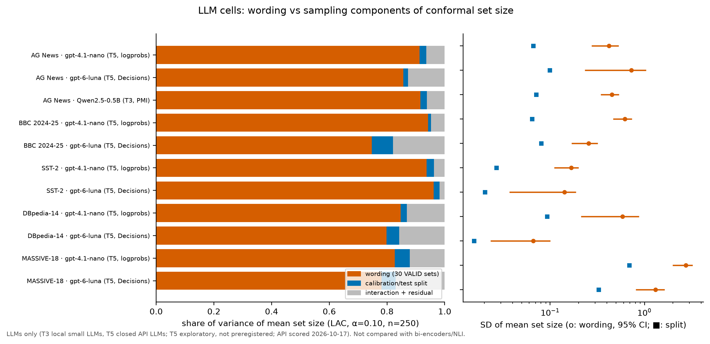

*Figure 17. Variance shares at n = 250 for the LLMs only (T3 local, T5 API).*

#### 3.10.2 gpt-6-luna specifics: quantised probabilities, refusals, batching, retest
- **Quantisation.** In the pilot (100 AG items × 31 sets) 100.0% of 61,960 returned probabilities lie on a 0.01 grid, with 101 distinct values: 62.5% are exactly 0 and 17.3% exactly 1, and every answer sums to 1 (Table A7). Over all AG News main-run sets, 60% are exactly 0 (Fig. 21).
- **Effect on LAC.** We floor at 1e-4, so every exact zero becomes the same tied smallest probability. If the true class gets p = 0 for more than α of the items, the conformal quantile lands on that tie and the sets jump to (almost) all K labels. On AG News, VALID sets 26 and 10 give the true class p at the floor for 16.6% and 13.9% of items. Their mean LAC set size is 1.00 and 0.95 of K (error rates 0.315 and 0.232). Sets 09 and 04, just above α at 10.7% and 10.3%, give 0.51 and 0.46 of K (`results/api/quant_jumps.json`, 50 splits). These jumps are what inflate the gpt-6-luna AG σ_w (0.727) and widen its CI ([0.233, 1.043]). No other dataset has a set with true-class floor share above 0.10, and none exceeds 0.51 of K. APS is less affected (AG share 0.85). The large AG value is therefore partly a property of the output format, not only of wording sensitivity.
- **Refusals.** Some answers come back as type "refusal" (stored as missing, scored as uniform), counted as item × set pairs: AG News 347 of 140,400, BBC 826 of 140,400, DBpedia 251 of 47,000, MASSIVE 682 of 56,400, SST-2 0. In the pilot, the 2 refusals per 3,100 pairs repeated exactly on the same item and set in every run.
- **Batching (pilot, Table A7).** Asking 1, 8 or 31 questions per request, and re-running each, gave max |Δp| = 0 and 0.000 argmax flips in all six comparisons (3,098 pairs each). The bitwise identity also held between the 60-question main run and the 1-question pilot on items 0–99.
- **Test-retest (Table A6).** Main run plus 2 reruns (AG items 0–199, 31 sets): max |Δp| = 0, ICC = Fleiss κ = 1.000, refusals identical, and 0.000 of LAC sets changed.

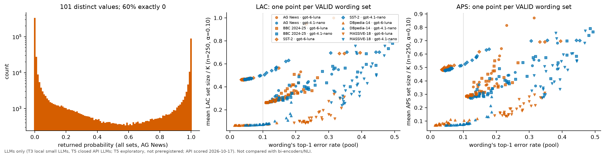

*Figure 21. Left: returned gpt-6-luna probabilities (AG News). Middle/right: mean LAC/APS set size ÷ K against each VALID set's error rate (LLMs only).*

#### 3.10.3 gpt-4.1-nano specifics: logprob scheme, missing letters, fingerprints, non-repeatability
- **Missing letters (Table A1).** The share of option letters absent from the top-20 logprobs, which get an upper-bound logprob, is 0.077 (SST-2), 0.177 (BBC), 0.183 (AG), 0.467 (MASSIVE) and 0.649 (DBpedia). For the 14- and 18-class datasets most non-top options therefore carry a bounded, tied score. This compresses the tail of the distribution, much as the 0.01 grid does for gpt-6-luna.
- **system_fingerprint drift.** All requests returned the model id `gpt-4.1-nano-2025-04-14`, but 8 distinct `system_fingerprint` values appeared across the runs (Table A6). The backend configuration changed between requests within one session.
- **Test-retest (Table A6, Fig. 20).** Three runs of the same 200 AG items × 31 sets at temperature 0, at 17:10–17:35, 17:38–17:41 and 17:48–17:51. The largest |Δp| is **0.927**; mean |Δp| is 0.00111 and the mean per-set max is 0.274. On average 37.9% of items change p in some run (up to 52.5% in one set). Argmax agreement across all three runs is 0.996 on average (minimum 0.985), and the Fleiss κ minimum is 0.983. The LAC set changes for **3.6%** of test items on average and for up to **15%** in one wording set.

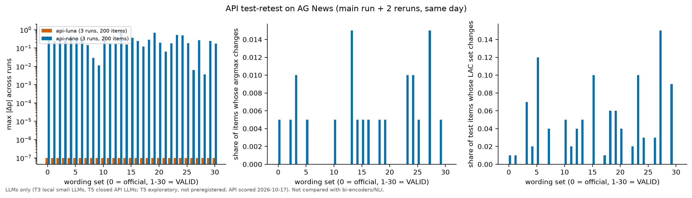

*Figure 20. Test-retest of the two API models (3 runs, AG News).*

#### 3.10.4 Option order as a separate source of uncertainty (Table A5, Fig. 19)
On AG News and BBC (first 600 items, 30 VALID sets), each set was also scored in two further random option orders, fixed per set and the same for all items. Order is nested within wording. A three-factor method-of-moments decomposition of mean LAC set size (n = 250, 200 splits) gives these shares:

| dataset | model | σ_wording [CI] | σ_order [CI] | σ_split | share wording | share order | share split | share w×s + residual | argmax flips between orders / vs official wording |
|---|---|---|---|---|---|---|---|---|---|
| AG News | gpt-6-luna | 0.620 [0.168, 0.943] | 0.224 [0.053, 0.376] | 0.058 | 0.81 | 0.11 | 0.007 | 0.08 | 0.043 / 0.095 |
| AG News | gpt-4.1-nano | 0.426 [0.292, 0.538] | 0.195 [0.125, 0.271] | 0.048 | 0.78 | 0.16 | 0.010 | 0.05 | 0.088 / 0.161 |
| BBC 2024-25 | gpt-6-luna | 0.199 [0.134, 0.244] | 0.086 [0.064, 0.107] | 0.042 | 0.72 | 0.13 | 0.031 | 0.12 | 0.063 / 0.113 |
| BBC 2024-25 | gpt-4.1-nano | 0.536 [0.375, 0.652] | 0.264 [0.173, 0.336] | 0.046 | 0.77 | 0.19 | 0.006 | 0.04 | 0.123 / 0.226 |

- Order is the **second-largest source** in all four cells: σ_order/σ_wording is 0.36–0.49, and σ_order is 2.0–5.7 times σ_split.
- Reordering the options flips about half as many predictions as changing the wording (0.043–0.123 vs 0.095–0.226).
- Mean accuracy hardly depends on order (for example BBC gpt-4.1-nano 0.742 / 0.748 / 0.759). The within-wording SD over orders (0.010–0.037) is smaller than the SD over wordings (0.040–0.100).
- gpt-4.1-nano shows a mild position bias: in the permuted orders, BBC gives a mean p of 0.21 at position B and 0.27 at position D. gpt-6-luna stays at 0.24–0.26.
- Under APS, the order share is 0.06–0.21.
- Option order is a specification choice of the same kind as wording and template, and an LLM budget that omits it understates the non-sampling part.

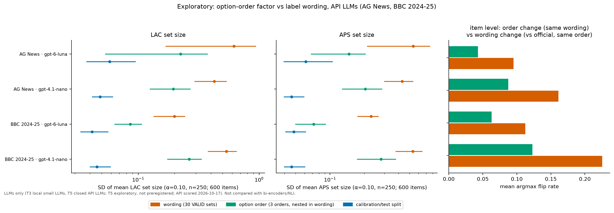

*Figure 19. Wording vs option order vs split sampling (API LLMs, AG News and BBC).*

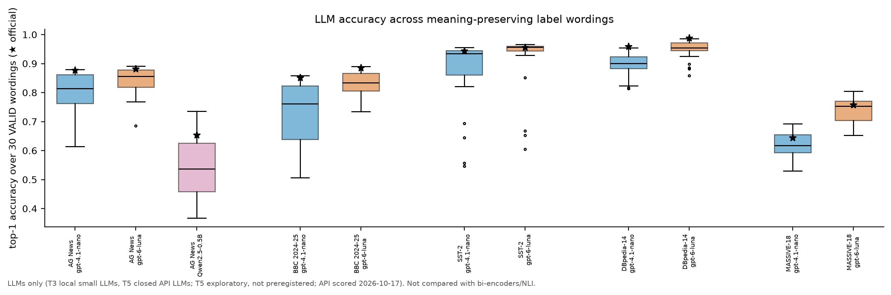

*Figure 22. Accuracy per wording set for the LLMs (T3, T5).*

**Spend.** The ledger (`logs/api/spend/*.json`, list prices, cached-token discounts ignored, so an upper bound) totals **$11.24** against the $23 cap. Main cells cost $8.99 (gpt-6-luna $5.97, gpt-4.1-nano $3.01); option order $0.96 + $0.76; retest $0.16 + $0.13; Luna pilot $0.24.

## 4. Verdicts on the v1 claims

*Update 2026-10-29: the cell counts in the rows below are from the stage at which each row was written. On the current 27 preregistered zero-shot cells (ModernBERT added) the verdict labels are unchanged: H1a 27/27, ratio > 3 in 17/27, ratio > 1 in all but the MASSIVE e5 cell (0.79), H2a window met in 0.48, H2b and H2c supported, case-only flips ≥ half the valid rate in 4/27. Adding the exploratory GLiNER cells (30 deterministic cells) does not change any of them either (§3.11.2).*

| # | v1 claim (X Article / repo) | v2 evidence | Verdict |
|---|---|---|---|
| 1 | "Label wording explained about 32% of the variance, calibration sampling about 64%" (Clef; qwen3.5: 55%/39%) | Re-analysis: the published-style share is 0.34 with CI [0.00, 0.84] (qwen3.5: 0.56 [0.00, 0.95]). The share depends on n (0.03 → 0.25 over n = 50…500), and the v2 method gives 0.23 [0.01, 0.37]. On v2 instruments the share is 0.31–0.88 (T2) and 0.92 (T3); exploratory API LLMs (T5): 0.75–0.96 over 10 cells. | **Refuted as a stable quantity.** The specific 32%/64% split is not a property of the instrument: its CI spans almost the whole range and it changes with n. The qualitative point that wording is a major component is confirmed (see 2). |
| 2 | "For zero-shot instruments, label wording is as large as calibration sampling at 250 calibration items" (ratio 0.71 Clef, 1.18 qwen3.5) | H1a 17/17. Preregistered H1b (ratio in [1/3, 3]) **refuted** because ratio > 3 in 9/17 cells. Ratio > 1 in 16/17. Median T2 ratio 2.94; T1 3.91; T3 6.38. T5 (exploratory): ratio 3.17–9.62, > 3 in 10/10 API cells. | **Refuted as stated ("comparable")**: on v2 instruments wording is usually *much larger* than split sampling, not merely as large. The weaker reading, "at least as large", holds in 16/17 cells; MASSIVE e5 (ratio 0.79) is the exception. The API LLMs strengthen this: no LLM cell comes near "comparable". |
| 3 | "Calibration noise fell 0.23 → 0.04 from n = 50 to 500", roughly as 1/√n | Falls in every cell; slopes −0.35 to −0.87 (H2a window met in only 50%); Design B AG MiniLM 0.253 → 0.034 | **Confirmed** that it falls; the √n rate is **weakened**: the decline is often steeper, especially near the pool limit. |
| 4 | "The wording part stalled near 0.02" (a floor) | Wording slope −0.04…0.03 with CI > 0 at n_max in 17/17; robust to W (0.87–0.96). T5: slope −0.08…0.01, CI > 0 at n_max in 10/10 | The **existence of a floor is confirmed** under a design that also varies the test set. The value 0.02 is instrument-specific (v2: 0.11–0.86 at n_max), and the published CI [0.018, 0.021] was too narrow, since it held wordings fixed (χ² CI for W = 4: [0.031, 0.201]). |
| 5 | Crossing "somewhere around n = 2,000" | n\* = 3–31 for 4 datasets (NLI AG: 15), 78–302 for MASSIVE | **Refuted for v2 instruments.** Wording overtakes sampling far earlier. The 2,000 figure was specific to Clef's small wording SD. |
| 6 | The floor "is the pattern a definitional floor would produce"; wording as a candidate for VIM 2.27 definitional uncertainty (v1 said "suggestive") | Floor confirmed, but any systematic effect gives a floor. Case-only changes reproduce 0.60 (T1 NLI) and 0.35 (T3) of the valid-paraphrase flip rate. Dose-response ρ = 0.56 (T2) and 0.51 (T1); T3 not significant. Validity filtering shrinks σ_w. Templates add a comparable component. Definitions shrink set-size levels in 15/15 T2 cells. | **Weakened.** Not refuted under the preregistered criterion: surface/valid ≥ 0.5 occurs in only 1/17 cells, not a majority. But the floor test only diagnoses *systematic vs random*. In the NLI cell most, and in the LLM cell a third, of the sensitivity is instrument non-invariance, and part of the T2 spread tracks how far a paraphrase drifts in meaning. Wording spread is better described as "systematic, partly definitional, partly instrument non-invariance". T5 adds two points. Case-only changes reproduce only 0.05–0.36 of the valid flip rate, but the order of the options (no meaning change at all) takes 0.11–0.19 of the variance and flips about half as many predictions as wording does. A second meaning-free specification choice of this size weakens the definitional reading further for LLMs. |
| 7 | "Wording mostly changes how big the sets are, less whether they contain the right answer" (coverage share 3%) | Coverage wording share 0.00 in all 17 cells (matched wording); re-analysis 0.01 for Clef | **Confirmed**, but only when calibration and deployment use the same wording (see 8). |
| 8 | Calibrate on one wording, deploy on another: "mean coverage barely moved", the range widened (Clef 0.855 → 0.863) | Mean coverage over valid sets 0.732–0.908; up to 0.77 of sets below 0.85; T1 AG 0.813 (min 0.617); T3 AG 0.770 (min 0.514); T5 0.755–0.897 (min 0.491) | **Refuted** for "mean coverage barely moves" (it drops well below target in several cells). The wider range is confirmed. |
| 9 | "Repeatability can be exactly zero for a deterministic classifier … on my stack" | CPU, fp32: 4 identical fresh-process runs give max \|Δp\| = 0.0 for NLI, bi-encoder and LLM; fp32 batch/thread changes ≤ 3e-6; bf16 changes 0.01–0.11 of conformal sets (T1, T2). A different batch composition gives 2e-6 to 2e-5, with no argmax change. | **Confirmed (partially tested)** for the local CPU instruments. Reproducibility under changed conditions is not bit-exact. **Partly refuted for API models (T5, exploratory):** gpt-6-luna was bitwise identical over 3 runs and over 1/8/31 questions per request. gpt-4.1-nano at temperature 0 was not: max \|Δp\| 0.927 over 3 runs, 37.9% of items moved, LAC sets changed for 3.6% of test items (max 15%), and 8 system fingerprints appeared. For a closed API model, repeatability is a property of the provider's serving stack and cannot be assumed to be zero. **Hardware change (exploratory, §3.11.1):** box CPU vs Apple M5 MPS, fp32: max \|Δp\| 8.1e-6, 0 argmax flips, LAC sets changed for 3e-6 of test items. Not bit-exact, but far below the bf16 effects. |
| 10 | AG News contamination "could explain the saturation" (raised as a gap) | T2: saturation ≈ 0 on both AG and BBC; σ_w *smaller* on BBC; accuracy only slightly lower on BBC. T3 and Min-K% pending. T5: VALID accuracy lower on BBC for both API models (0.795 → 0.725; 0.843 → 0.832), σ_w up for gpt-4.1-nano (0.420 → 0.617) and down for gpt-6-luna (0.727 → 0.255) | **Weakened for T2** (no sign that newer texts make wording effects larger). For LLMs it is still **open**: the two API models disagree in direction. |
| 11 | "Determinism didn't remove the uncertainty. It moved it into choices I make as the person posing the question." | Deterministic zero-shot instruments: 0 repeatability spread, wording share 0.31–0.92. Supervised probes (no wording): split sampling dominates. Template adds a further choice component; for LLMs, so does the option order (share 0.11–0.19). | **Confirmed**, and extended: for API LLMs part of the uncertainty also sits in the provider's serving stack (gpt-4.1-nano retest), which the user does not choose at all. |

Not re-tested in v2: the aleatoric/epistemic split (H4 of v1), the Clef name/definition swap, the RSS-vs-Monte-Carlo check and the synthetic typo shift. v1's "9B vs 27B made no difference" is not tested either; Qwen2.5-1.5B is pending.

## 5. Limitations
1. **Interim and unbalanced.** 15 of 17 zero-shot cells are bi-encoders. The NLI and LLM evidence is one cell each (one model, AG News only). Claims about "zero-shot instruments" in general are mostly claims about small bi-encoders.
2. **Small local models only** (≤ 0.5B LLM, ≤ 110M-class encoders). The exploratory API cells (§3.10) show that two much more accurate closed LLMs still have wording shares of 0.75–0.96. They are closed, can change silently, and gpt-6-luna's 0.01-quantised output interacts with LAC (§3.10.2), so they do not replace a reproducible larger open model.
3. **Paraphrase population is constructed** (automatic generators, one LLM paraphraser, fixed definitions), judged by models and one researcher, with no human raters. σ_wording is defined relative to this population.
4. **Case-only control is uninformative for T2**, since flips are 0, so for T2 we cannot separate non-invariance from definitional spread with this control.
5. **Finite pools.** Large-n behaviour is affected by pool exhaustion, which is one plausible reason for the steep split slopes. BBC and DBpedia pools are smaller (n_max 1,938 and 1,100).
6. **RQ4 is a proxy comparison.** AG and BBC differ in source and style as well as date, there are no accuracy-difference CIs yet, and Min-K% has not run.
7. **CPU stack only.** Repeatability was tested on one box and does not transfer to other hardware or libraries. The v1 Mac instruments were not re-run.
8. **English only.**
9. **The template factor is exploratory and T2 only.** The main design holds the template fixed, so σ_wording is conditional on the template "This text is about {}." for T2.
10. **API cells are a dated snapshot** (2026-10-17, model ids `gpt-6-luna` and `gpt-4.1-nano-2025-04-14`). The output formats differ from local scoring: per-option probabilities on a 0.01 grid, and first-token letter logprobs truncated at the top 20, so options are presented as a list and their order matters. Only AG News and BBC have the order and retest runs, and the retest uses 200 items.

## 6. A short philosophical discussion
v1 asked whether label wording is part of the measurand. The v2 data make the question sharper, but they cannot settle it, because the answer is a decision about the measurand and not an empirical finding. If the measurand is "set size given the class *concepts*", every valid wording realises the same definition, and the spread is the price of the definition's limited detail (VIM 2.27). If the measurand is "set size given *this* label string", the spread is an instrument non-invariance under a change of procedure (GUM 3.3.2 b, i). The floor test cannot tell these apart: anything systematic refuses to average out. What the data do show is that the spread is *graded*. It grows with the semantic distance of a paraphrase (bi-encoders, ρ = 0.56). Validity filtering removes part of it. Meaningless case changes reproduce a third of it in the small LLM and 0.60 of it in the NLI cross-encoder. Swapping a name for a definition moves the level a lot. The wording component is therefore not one thing: it is a mixture of definitional looseness and instrument non-invariance, in proportions that depend on the instrument.

That does not make the budget useless. It makes it relative to a choice the person posing the question must state. Determinism does not remove uncertainty; it moves it from the run into the specification. A metrologically honest report of a zero-shot classifier's conformal set size should state the measurand (concept or string), the wording population and the template, and report the wording component next to sampling. Otherwise the conformal guarantee holds for a measurand nobody specified. The configuration-shift result (coverage 0.732–0.908 when wording changes after calibration) shows what is at stake: the guarantee belongs to the wording it was calibrated on.

## 7. Pending runs
**State at 08:40 on 2026-10-29 (Europe/Madrid, UTC+1).** No Mac job is running or pending. ModernBERT x5, GLiNER2.5-Decide x5 and Clef-flash x5 are finished and analysed (Clef: `run_seq2.sh` ended 07:15:14 with `CLEF_EXIT rc=0` and `SEQ2_DONE`; caches copied to `raw/schema_cache/clef/` with matching sha256; analysed as `_sub200` cells with `UQ_TEST_SIZE=100`; Tables M3/M3b).

Box-side items still open from earlier sessions: the Min-K% write-up (§3.6) and the stopped local LLM cells (Qwen sst2+, SmolLM2), which were dropped for the preprint.

## 8. Reproducibility
Raw per-item scores (`raw/*.npz`), per-cell analyses (`results/cells/`), label candidates and validity judgements (`data/labels_*.json`), wording sets (`data/wordsets_*.json`) and every script are in `v2/`. BBC-2025 texts are replaced by hashes (`data/bbc2025_public.json`); rebuild them with `src/prep_data.py bbc`. API-LLM raw responses (per-request JSONL caches with probabilities/logprobs, token usage, model id and system fingerprint; no article texts) are shipped as `raw/api_cache.tar.gz` (unpack with `tar -xzf raw/api_cache.tar.gz -C raw`, then `python src/api_build.py`); re-scoring needs an API key and will not reproduce the gpt-4.1-nano numbers bit-for-bit (§3.10.3). Progress log: `PROGRESS.md`.

## References
- JCGM 200:2012, International Vocabulary of Metrology (VIM 3), 2.27 definitional uncertainty: https://jcgm.bipm.org/vim/en/2.27.html
- JCGM 100:2008, Evaluation of measurement data: Guide to the expression of uncertainty in measurement (GUM): https://www.bipm.org/documents/20126/2071204/JCGM_100_2008_E.pdf
- v1 article: https://x.com/mehanixs/status/2111363921655255405 ; repo: https://github.com/detasar/gum-uncertainty-budget-textclf
- Petri & Mari (2026), Uncertainty Evaluation: Bridging Machine Learning and Measurement Science. https://arxiv.org/abs/2610.18066
- Sadinle, Lei & Wasserman (2019), Least Ambiguous Set-Valued Classifiers with Bounded Error Levels. https://arxiv.org/abs/1609.00451
- Romano, Sesia & Candès (2020), Classification with Valid and Adaptive Coverage. https://arxiv.org/abs/2006.02544
- Angelopoulos, Bates, Malik et al. (2021), Uncertainty Sets for Image Classifiers using Conformal Prediction. https://arxiv.org/abs/2009.14193
- Angelopoulos & Bates (2021), A Gentle Introduction to Conformal Prediction. https://arxiv.org/abs/2107.07511
- Zhu, Yu & Li (2026), Conformalized Large Language Models under Configuration Shift. https://arxiv.org/abs/2608.01460
- Xin et al. (2026), Conformal Prediction with Paraphrase-Aware Scoring for LLM Uncertainty Quantification. https://arxiv.org/abs/2610.04239
- Kumar et al. (2023), Conformal Prediction with LLMs for Multi-Choice QA. https://arxiv.org/abs/2305.18404
- Quach et al. (2023), Conformal Language Modeling. https://arxiv.org/abs/2306.10193
- Su et al. (2024), API Is Enough: Conformal Prediction for LLMs Without Logit-Access. https://arxiv.org/abs/2403.01216
- Ye et al. (2024), Benchmarking LLMs via Uncertainty Quantification. https://arxiv.org/abs/2401.12794
- Stutz et al. (2023), Conformal prediction under ambiguous ground truth. https://arxiv.org/abs/2307.09302
- Sclar, Choi & Tsvetkov (2023), Quantifying Language Models' Sensitivity to Spurious Features in Prompt Design. https://arxiv.org/abs/2310.11324
- Mizrahi et al. (2023), State of What Art? A Call for Multi-Prompt LLM Evaluation. https://arxiv.org/abs/2401.00595
- Zhuo et al. (2024), ProSA. https://arxiv.org/abs/2410.12405
- Chatterjee et al. (2024), POSIX: A Prompt Sensitivity Index. https://arxiv.org/abs/2410.02185
- Polo et al. (2024), Efficient multi-prompt evaluation of LLMs. https://arxiv.org/abs/2405.17202
- Weber, Bruni & Hupkes (2023), Mind the instructions. https://arxiv.org/abs/2310.13486
- Gonen et al. (2022), Demystifying Prompts in Language Models via Perplexity Estimation. https://arxiv.org/abs/2212.04037
- Pecher, Spiegel & Belanec (2026), Revisiting Prompt Sensitivity in LLMs for Text Classification: The Role of Prompt Underspecification. https://arxiv.org/abs/2602.04297
- Sun, Xu & Shi (2026), Type-Safe Is Not Error-Free. https://arxiv.org/abs/2609.26758
- Reiter, Kern & Miasnikov (2026), Reliable but Design-Sensitive: Instrument Uncertainty in LLM Annotation. https://arxiv.org/abs/2609.35824
- Holtzman et al. (2021), Surface Form Competition. https://arxiv.org/abs/2104.08315
- Zhao et al. (2021), Calibrate Before Use. https://arxiv.org/abs/2102.09690
- Zheng et al. (2023), Large Language Models Are Not Robust Multiple Choice Selectors. https://arxiv.org/abs/2309.03882
- Yin, Hay & Roth (2019), Benchmarking Zero-shot Text Classification. https://arxiv.org/abs/1909.00161
- Laurer et al. (2023), Building Efficient Universal Classifiers with Natural Language Inference. https://arxiv.org/abs/2312.17543
- Bouthillier et al. (2021), Accounting for Variance in Machine Learning Benchmarks. https://arxiv.org/abs/2103.03098
- Hassanzadeh & Subramanian (2026), Same Query, Different Answer. https://arxiv.org/abs/2610.13823
- Qin, Du & Zhang (2026), Vosti: Deterministic LLM Inference. https://arxiv.org/abs/2609.38981
- Shi et al. (2023), Detecting Pretraining Data from LLMs (Min-K% Prob). https://arxiv.org/abs/2310.16789
- Sainz et al. (2023), NLP Evaluation in trouble. https://arxiv.org/abs/2310.18018
- Li et al. (2023), LatestEval. https://arxiv.org/abs/2312.12343
- Sharma, Duncan & Caron (2026), TypedBench. https://arxiv.org/abs/2610.11392
- Plank (2022), The "Problem" of Human Label Variation. https://arxiv.org/abs/2211.02570
- Zhang, Zhao & LeCun (2015), Character-level Convolutional Networks for Text Classification (AG News, DBpedia). https://arxiv.org/abs/1509.01626
- Socher et al. (2013), Recursive Deep Models for Semantic Compositionality over a Sentiment Treebank (SST-2). https://aclanthology.org/D13-1170/
- FitzGerald et al. (2022), MASSIVE. https://arxiv.org/abs/2204.08582
- BBC News 2024–25 source: https://huggingface.co/datasets/RealTimeData/bbc_news_alltime
